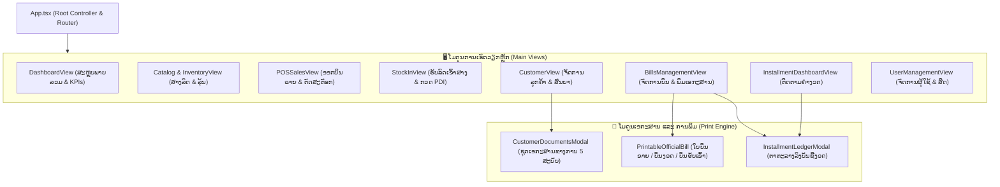

# ສ່ວນທີ 1: ລະບົບເວັບແອັບພລິເຄຊັນ ແລະ ການມອບ-ຮັບງານ
## PART 1: WEB APPLICATION ARCHITECTURE & DELIVERABLES SPECIFICATION

---

### 1. ສະຖາປັດຕະຍະກຳດ້ານເທັກໂນໂລຢີ (Frontend Technology Stack)

ລະບົບເວັບແອັບພລິເຄຊັນ **AvatrAutoService** ຖືກອອກແບບ ແລະ ພັດທະນາດ້ວຍມາດຕະຖານ Single Page Application (SPA) ລະດັບສູງ ເນັ້ນຄວາມໄວໃນການໂຫຼດ, ຄວາມຖືກຕ້ອງຂອງຂໍ້ມູນການເງິນ, ແລະ ຄວາມປອດໄພ:

| ໝວດໝູ່ (Category) | ເທັກໂນໂລຢີທີ່ເລືອກໃຊ້ (Technology) | ລຸ້ນ (Version) | ຈຸດປະສົງ ແລະ ເຫດຜົນ (Purpose & Rationale) |
| :--- | :--- | :---: | :--- |
| **Framework** | **React** | `19.0.0` | ປະສິດທິພາບສູງ, ຮອງຮັບ Concurrent Rendering, ຈັດການ State ໄດ້ໄວ |
| **Type Safety** | **TypeScript** | `5.7+` | ຄວບຄຸມ Type Strict ປ້ອງກັນ Runtime Error ໃນການຄິດໄລ່ເງິນ ແລະ ສະຕັອກ |
| **Build Tool** | **Vite** | `6.0+` | ຮອງຮັບ Hot Module Replacement (HMR) ໄວສູງ ແລະ ແຍກ Bundle ຂະໜາດນ້ອຍ |
| **Styling** | **Tailwind CSS** | `3.4+` | Utility-first CSS ຮອງຮັບ Responsive Design, Dark Luxury Theme ແລະ Print Layout |
| **UI Icons** | **Lucide React** | `0.475+` | Icon ຊຸດມາດຕະຖານ Vector SVG ຂະໜາດເບົາ |
| **PDF Engine** | **html2canvas + jsPDF** | `Custom Wrap` | ສ້າງໄຟລ໌ PDF ເອກະສານ A4 ໜ້າດຽວຄົມຊັດ (Single-Page Exact Scaling) |
| **Font Assets** | **Phetsarath WOFF2** | `Local Caching` | ຟອນພາສາລາວ WOFF2 ຝັງໃນລະບົບ ໂຫຼດໄວ ແລະ ຕັດການເພິ່ງພາ Google Fonts ພາຍນອກ |

---

### 2. ໂຄງສ້າງລະບົບ ແລະ ໂມດູນຫຼັກ (Core Application Modules)

---

### 3. ລາຍລະອຽດແຕ່ລະໂມດູນ (Detailed Module Specifications)

#### 3.1 ໂມດູນໂຊຣູມ ແລະ ລຸ້ນລົດ (Showroom Catalog & Models)
- **ລາຍການລົດຫຼັກ:** ຮອງຮັບການສະແດງລົດ AVATR 11, AVATR 12, ແລະ AVATR 07
- **ປັບແຕ່ງສີ ແລະ ສະເປັກ:** ເລືອກສີພາຍນອກ ( Damson Metallic, Mountain Green, ຯລຯ), ສີພາຍໃນ, ຂະໜາດແບັດເຕີຣີ CATL, ແລະ ລະບົບຂັບເຄື່ອນອັດສະລິຍະ Huawei ADS
- **ອັບເດດລາຄາ Real-Time:** ສະແດງລາຄາເລີ່ມຕົ້ນທັງສະກຸນເງິນ **USD ($)** ແລະ **LAK (₭)** ຕາມອັດຕາແລກປ່ຽນປັດຈຸບັນ

#### 3.2 ໂມດູນຈຸດຂາຍ ແລະ ອອກບິນ (POS & Billing System)
- **ລະບົບຄຳນວນເງິນສົດ ແລະ ໂອນ:** ຮອງຮັບຫຼາຍສະກຸນເງິນ (USD, LAK, THB, CNY) ພ້ອມອັດຕາແລກປ່ຽນອັດຕະໂນມັດ
- **QR Code ຊຳລະເງິນທາງການ:** ດຶງຮູບພາບ BCEL OnePay QR Code ທີ່ອັບໂຫຼດໂດຍ Super Admin ຈາກ Supabase Storage ມາສະແດງທັນທີ
- **ການຕັດສະຕັອກອັດຕະໂນມັດ:** ເມື່ອຢືນຢັນການຂາຍ ລະບົບຈະປ່ຽນສະຖານະຂອງລົດໃນສາງຈາກ `ready` ເປັນ `sold` ໂດຍບໍ່ມີການຂາຍຊ້ຳຊ້ອນ (Race Condition Prevention)

#### 3.3 ໂມດູນຮັບລົດເຂົ້າສາງ ແລະ ກວດສະພາບ PDI (Inbound Stock-In & Inventory)
- **ບັນທຶກລະຫັດຖັງ (VIN 17 ຕົວ):** ມີລະບົບ Sanitize ກວດສອບຄວາມຖືກຕ້ອງ ແລະ ເລກມໍເຕີ (Motor No.)
- **ການກວດ PDI (Pre-Delivery Inspection):** ລະບຸສະຖານະການກວດຮັບ (`passed`, `in_progress`, `pending`), ຊື່ຊ່າງກວດຮັບ, ແລະ ຄັງສິນຄ້າປາຍທາງ
- **ໃບຮັບເຂົ້າສິນຄ້າ (Goods Receipt A4):** ສາມາດພິມເອກະສານຮັບລົດເຂົ້າສາງທາງການໄດ້ທັນທີ

#### 3.4 ໂມດູນລູກຄ້າ ແລະ ຊຸດເອກະສານທາງການ 5 ສະບັບ (Official A4 Documents Suite)
ຢູ່ໃນໂມດູນ [`CustomerDocumentsModal.tsx`](file:///home/pheuang01/Projects/AvatrAutoService/src/components/modals/CustomerDocumentsModal.tsx) ປະກອບມີຊຸດເອກະສານມາດຕະຖານ A4 ຄົບຖ້ວນ:
1. **ໃບສັນຍາສັ່ງຈອງ (Vehicle Booking Contract):** ລະບຸເງື່ອນໄຂການຈອງ, ລາຄາລົດ, ເງິນມັດຈຳ, ຂອງແຖມ, ແລະ ກຳນົດສົ່ງມອບ
2. **ໃບຮັບເງິນ (Official Dealership Receipt):** ໃບຮັບເງິນທາງການລະບຸຍອດຈ່າຍ, ເລກອ້າງອີງການໂອນ, ວັນທີເວລາ, ແລະ ຊ່ອງລົງລາຍເຊັນ 3 ຝ່າຍ (ລູກຄ້າ, ພະນັກງານຮັບເງິນ, ຫົວໜ້າບັນຊີ)
3. **ໃບມອບ-ຮັບລົດ (Vehicle Handover Certificate):** ເອກະສານກວດກາ ແລະ ສົ່ງມອບຍານພາຫະນະ ພ້ອມລາຍການອຸປະກອນແຖມ (Adapter CCS2, Home Charger 7kW, ບັດສາກໄຟ Bluedot)
4. **ໃບມອບສິດ (Power of Attorney):** ໃບມອບສິດທາງການເພື່ອດຳເນີນການຂຶ້ນທະບຽນ ແລະ ເອົາປ້າຍລົດນຳພະແນກໂຍທາທິການ ແລະ ຂົນສົ່ງ
5. **ຕາຕະລາງຜ່ອນຊຳລະ (Installment Schedule):** ຕາຕະລາງໄລ່ຄ່າງວດແຕ່ລະເດືອນ ລະບຸເງິນຕົ້ນ, ດອກເບ້ຍ, ແລະ ຍອດຄົງເຫຼືອທັງ USD ແລະ LAK

#### 3.5 ໂມດູນຕິດຕາມຄ່າງວດ (Installment Ledger & Repayment)
- **ຄຳນວນດອກເບ້ຍ ແລະ ຄ່າງວດ:** ຮອງຮັບການວາງດາວ 10% - 90% ແລະ ໄລຍະເວລາຜ່ອນ 12 ຫາ 60 ເດືອນ
- **ບັນທຶກການຊຳລະງວດ:** ອອກໃບບິນຮັບເງິນງວດຍ່ອຍ (Period Receipts) ພ້ອມອັບເດດສະຖານະ `paid`, `due`, `overdue` ແບບ Realtime

---

### 4. ສະເປັກການ Deploy ແລະ Hosting (Deployment Specifications)

> [!NOTE]
> ລາຍລະອຽດຂັ້ນຕອນການ Deploy ຢ່າງລະອຽດທັງແບບ Cloudflare Dashboard GUI ແລະ Wrangler CLI ສາມາດເບິ່ງໄດ້ທີ່ **[`04_cloudflare_deployment_guide.md`](file:///home/pheuang01/Projects/AvatrAutoService/docs/handover/04_cloudflare_deployment_guide.md)**.

- **Platform:** Cloudflare Pages (Global Edge Network)
- **Subdomain:** `https://avatr-auto-service.pages.dev`
- **Build Environment:** Node.js version `20+` ຫຼື `24`
- **Build Command:** `npm run build`
- **Output Directory:** [`dist/`](file:///home/pheuang01/Projects/AvatrAutoService/dist)
- **Single Page Application Routing:** กำหนดใน [`wrangler.jsonc`](file:///C:/Users/HP/Projects/AvatrAutoService/wrangler.jsonc) (`"not_found_handling": "single-page-application"`) สำหรับ Cloudflare Workers Static Assets (ບໍ່ໃຊ້ໄຟລ໌ `_redirects` ເພື່ອປ້ອງກັນ Infinite Loop code: 100324)
- **Security & Cache Headers:** [`public/_headers`](file:///home/pheuang01/Projects/AvatrAutoService/public/_headers) (Content-Security-Policy, HSTS, X-Frame-Options: DENY, Cache-Control)
- **Static Asset Optimization:**
  - Font ໄຟລ໌ພາສາລາວ WOFF2 ຝັງຢູ່ໃນ `public/fonts/` ພ້ອມ HTTP Header: `Cache-Control: public, max-age=31536000, immutable`
  - Vendor Chunk Splitting ໃນ [`vite.config.ts`](file:///home/pheuang01/Projects/AvatrAutoService/vite.config.ts) (ແຍກ React, Supabase, Lucide ອອກຈາກ bundle ຫຼັກ)
- **Required Environment Variables:**
  - `NODE_VERSION` = `20`
  - `VITE_SUPABASE_URL` = `<Supabase Project URL>`
  - `VITE_SUPABASE_ANON_KEY` = `<Supabase Anon Public Key>`
  - `VITE_TURNSTILE_SITE_KEY` = `<Cloudflare Turnstile Site Key>`
  - `VITE_APP_ENV` = `production`

---

### 5. ລາຍການກວດຮັບງານເວັບ (Web User Acceptance Testing Checklist)

| ລຳດັບ | ລາຍການທົດສອບ (Test Item) | ຂັ້ນຕອນການທົດສອບ (Test Procedure) | ຜົນທີ່ຄາດຫວັງ (Expected Result) | ສະຖານະກວດຮັບ |
| :---: | :--- | :--- | :--- | :---: |
| 1 | **ລະບົບເຂົ້າສູ່ລະບົບ (Authentication)** | ເຂົ້າສູ່ລະບົບດ້ວຍ Email & Password ຂອງພະນັກງານ | ເຂົ້າສູ່ລະບົບໄດ້ຖືກຕ້ອງ ດຶງຊື່ ແລະ ສິດຂອງ Role ຖືກຕ້ອງ | [ ] ຜ່ານ |
| 2 | **ການເລືອກລຸ້ນ ແລະ ສະເປັກ (Catalog)** | ເລືອກລຸ້ນ AVATR 11, 12, 07 ແລະ ປ່ຽນສີ | ລາຄາ ແລະ ຮູບພາບອັບເດດຖືກຕ້ອງທັງ USD/LAK | [ ] ຜ່ານ |
| 3 | **ການອອກບິນຂາຍ (POS Sale)** | ກົດເລືອກລົດ, ເລືອກລູກຄ້າ, ເລືອກວິທີຊຳລະ, ຢືນຢັນການຂາຍ | ອອກບິນສຳເລັດ, ສະຕັອກລົດຖືກຕັດເປັນ `sold` ທັນທີ | [ ] ຜ່ານ |
| 4 | **ການຮັບລົດເຂົ້າສາງ (Stock In)** | ປ້ອນ VIN 17 ຕົວ, ເລືອກລຸ້ນ, ໃສ່ຂໍ້ມູນດ່ານ ແລະ ກວດ PDI | ຂໍ້ມູນບັນທຶກເຂົ້າຖານຂໍ້ມູນ ສະແດງໃນສາງທັນທີ | [ ] ຜ່ານ |
| 5 | **ການພິມເອກະສານ A4 (Print)** | ກົດປຸ່ມ "ພິມເອກະສານ (Print A4)" ໃນແຕ່ລະໃບ | ສະແດງ Preview ຂະໜາດ A4 ພໍດີ 1 ໜ້າ ຕົວໜັງສືຄົມຊັດ | [ ] ຜ່ານ |
| 6 | **ການສົ່ງອອກ PDF (Download PDF)** | ກົດປຸ່ມ "ບັນທຶກເປັນ PDF (A4)" | ດາວໂຫຼດໄຟລ໌ PDF ອອກມາໄດ້ ໜ້າດຽວ ຊື່ໄຟລ໌ກົງກັບຊື່ລູກຄ້າ | [ ] ຜ່ານ |
| 7 | **ການເຊື່ອມຕໍ່ WhatsApp** | ກົດປຸ່ມ WhatsApp ໃນໜ້າລູກຄ້າ | ເປີດແອັບ WhatsApp ພ້ອມຂໍ້ຄວາມທັກທາຍ ແລະ ລຸ້ນລົດທີ່ສົນໃຈ | [ ] ຜ່ານ |
| 8 | **ການຄວບຄຸມສິດ (RBAC)** | ລັອກອິນດ້ວຍບັນຊີ Sales ທົດລອງເຂົ້າໜ້າ User Management | ລະບົບປິດກັ້ນການເຂົ້າເຖິງ ບໍ່ອະນຸຍາດໃຫ້ແກ້ໄຂສິດ | [ ] ຜ່ານ |
