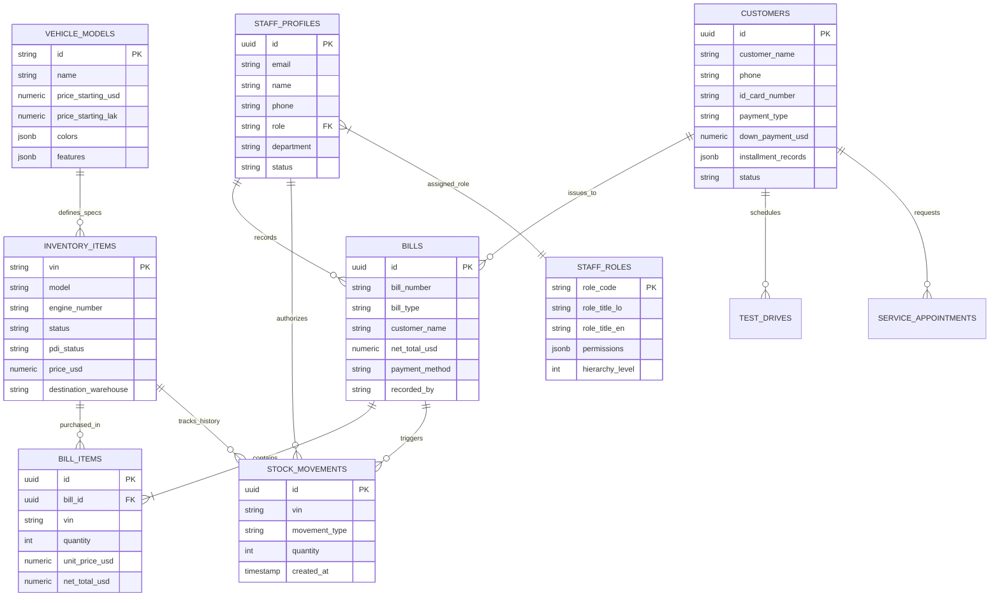

# ສ່ວນທີ 2: ສະຖາປັດຕະຍະກຳຖານຂໍ້ມູນ
## PART 2: DATABASE ARCHITECTURE & DATA DICTIONARY

---

### 1. ສະຫຼຸບພາບລວມຖານຂໍ້ມູນ (Database Overview & Engine)

ລະບົບ **AvatrAutoService** ນຳໃຊ້ຖານຂໍ້ມູນ **Supabase Cloud (PostgreSQL 15+)** ລະດັບ Enterprise ເຊິ່ງມີຄວາມປອດໄພສູງ, ຮອງຮັບ ACID Transactions ຄົບຖ້ວນ, ແລະ ມີລະບົບ Realtime Data Streaming:

- **Database Engine:** PostgreSQL 15+ (Relational Database Management System)
- **Primary Schema:** `public` (Application Schema) & `auth` (Supabase Identity Schema)
- **Security Definer Isolation:** ທຸກໆຟັງຊັນ (RPCs) ມີການກຳນົດ `SET search_path = public` ຢ່າງເຂັ້ມງວດເພື່ອປ້ອງກັນ Search-path Hijacking
- **Row-Level Security (RLS):** ເປີດໃຊ້ງານ RLS ໃນທຸກໆຕາຕະລາງ 100% ບໍ່ມີຕາຕະລາງໃດທີ່ປະໄວ້ແບບ Open Access

---

### 2. ແຜນຜັງຄວາມສຳພັນຂອງຂໍ້ມູນ (Entity-Relationship Diagram: ERD)



---

### 3. ລາຍລະອຽດຕາຕະລາງ (Comprehensive Data Dictionary)

#### 3.1 ຕາຕະລາງ `public.staff_profiles` (ໂປຣໄຟລ໌ພະນັກງານ)
ເກັບຂໍ້ມູນພະນັກງານທີ່ຜູກກັບບັນຊີ `auth.users`:

| ຊື່ຟິວ (Column Name) | ປະເພດ (Data Type) | ຂໍ້ກຳນົດ (Constraints) | ຄຳອະທິບາຍ (Description) |
| :--- | :--- | :--- | :--- |
| `id` | `uuid` | PK, FK -> `auth.users(id)` | ລະຫັດ UID ຂອງບັນຊີຜູ້ໃຊ້ |
| `email` | `text` | NOT NULL | ອີເມລພະນັກງານ |
| `name` | `text` | NOT NULL | ຊື່ ແລະ ນາມສະກຸນພະນັກງານ |
| `phone` | `text` | NULLABLE | ເບີໂທລະສັບຕິດຕໍ່ |
| `role` | `text` | FK -> `staff_roles(role_code)` | ລະຫັດສິດ (`super_admin`, `admin`, `sales`, `technician`, `general_user`) |
| `department` | `text` | DEFAULT `'Showroom'` | ພະແນກ (ເຊັ່ນ: ການຂາຍ, ການເງິນ, ສ້ອມແປງ) |
| `role_title` | `text` | DEFAULT `''` | ຕຳແໜ່ງງານສະເພາະ |
| `status` | `text` | CHECK (`active`, `suspended`) | ສະຖານະການໃຊ້ງານ |
| `last_login` | `timestamptz` | NULLABLE | ວັນທີເວລາເຂົ້າສູ່ລະບົບຫຼ້າສຸດ |
| `created_at` | `timestamptz` | DEFAULT `now()` | ວັນທີສ້າງບັນຊີ |

#### 3.2 ຕາຕະລາງ `public.vehicles` (ສາງລົດຍົນ / Inventory Items)
ເກັບລາຍລະອຽດລົດແຕ່ລະຄັນໃນສາງ (Frontend Interface: `InventoryItem`):

| ຊື່ຟິວ (Column Name) | ປະເພດ (Data Type) | ຂໍ້ກຳນົດ (Constraints) | ຄຳອະທິບາຍ (Description) |
| :--- | :--- | :--- | :--- |
| `vin` | `text` | PK, LENGTH = 17 | ເລກຖັງລົດຍົນ (Vehicle Identification Number) |
| `model` | `text` | NOT NULL | ຊື່ລຸ້ນລົດ (AVATR 11, AVATR 12, AVATR 07) |
| `engine_number` | `text` | NULLABLE | ເລກມໍເຕີ / ເລກຈັກ (Motor Serial No.) |
| `plate_number` | `text` | DEFAULT `'ປ້າຍແດງ'` | ປ້າຍທະບຽນລົດ |
| `color` | `text` | NOT NULL | ສີພາຍນອກຂອງລົດ |
| `interior_color` | `text` | DEFAULT `'Burgundy/Caramel'` | ສີພາຍໃນຫ້ອງໂດຍສານ |
| `trim` | `text` | DEFAULT `'Standard Edition'` | ຮຸ່ນຍ່ອຍ / Option Trim |
| `battery` | `text` | DEFAULT `'CATL Shenxing Cell'` | ປະເພດແບັດເຕີຣີ |
| `price_usd` | `numeric` | CHECK (`>= 0`) | ລາຄາຂາຍລົດ (USD) |
| `price_lak` | `numeric` | CHECK (`>= 0`) | ລາຄາຂາຍລົດ (LAK) |
| `status` | `text` | CHECK in allowed values | ສະຖານະ (`ready`, `reserved`, `sold`, `pdi`, `imported`, `event`) |
| `pdi_status` | `text` | CHECK (`passed`, `in_progress`, `pending`) | ສະຖານະການກວດສະພາບ PDI |
| `pdi_inspector` | `text` | NULLABLE | ຊ່າງເຕັກນິກຜູ້ກວດສອບ PDI |
| `destination_warehouse`| `text` | DEFAULT `'ສາງໃຫຍ່ ຫຼັກ 7'` | ສະຖານທີ່ເກັບຮັກສາລົດ |
| `import_doc_number` | `text` | NULLABLE | ເລກທີໃບແຈ້ງພາສີນຳເຂົ້າ (B01) |

#### 3.3 ຕາຕະລາງ `public.customers` (ຖານຂໍ້ມູນລູກຄ້າ & ສັນຍາ)
ເກັບຂໍ້ມູນລູກຄ້າ CRM ແລະ ຂໍ້ມູນການເງິນ/ສັນຍາຜ່ອນ:

| ຊື່ຟິວ (Column Name) | ປະເພດ (Data Type) | ຂໍ້ກຳນົດ (Constraints) | ຄຳອະທິບາຍ (Description) |
| :--- | :--- | :--- | :--- |
| `id` | `uuid` | PK, DEFAULT `gen_random_uuid()` | ລະຫັດລູກຄ້າ |
| `customer_name` | `text` | NOT NULL | ຊື່ ແລະ ນາມສະກຸນລູກຄ້າ |
| `phone` | `text` | NOT NULL | ເບີໂທລະສັບລູກຄ້າ (ໃຊ້ເຊື່ອມຕໍ່ WhatsApp ໄດ້) |
| `id_card_number` | `text` | NULLABLE | ເລກບັດປະຈຳຕົວ / ສຳມະໂນຄົວ / Passport |
| `province` | `text` | DEFAULT `'ນະຄອນຫຼວງວຽງຈັນ'` | ແຂວງທີ່ຢູ່ |
| `district` | `text` | NULLABLE | ເມືອງ |
| `village` | `text` | NULLABLE | ບ້ານ |
| `interested_model`| `text` | NOT NULL | ລຸ້ນລົດທີ່ລູກຄ້າສົນໃຈ |
| `status` | `text` | CHECK in lead statuses | ສະຖານະ (`new`, `contacted`, `test_drive`, `delivered`, `lost`) |
| `payment_type` | `text` | NULLABLE | ຮູບແບບການຊຳລະ (`cash`, `transfer`, `finance`, `installment`) |
| `down_payment_percent`| `numeric`| NULLABLE | ສັດສ່ວນເງິນດາວ (%) ເຊັ່ນ 30% |
| `down_payment_usd`| `numeric` | NULLABLE | ຈຳນວນເງິນດາວຕົວຈິງ (USD) |
| `tenure_months` | `integer` | NULLABLE | ໄລຍະເວລາຜ່ອນ (ເດືອນ: 12, 24, 36, 48, 60) |
| `paid_amount_usd` | `numeric` | NULLABLE | ຍອດເງິນທີ່ໄດ້ຊຳລະແລ້ວຕົວຈິງ (USD) |
| `payment_receipt_no` | `text` | NULLABLE | ເລກທີໃບຮັບເງິນທາງການ (Official Receipt No.) |
| `installment_records`| `jsonb` | DEFAULT `'[]'::jsonb` | ຕາຕະລາງລົງບັນຊີງວດແຕ່ລະເດືອນ (Ledger Rows) |

#### 3.4 ຕາຕະລາງ `public.bills` ແລະ `public.bill_items` (ໃບບິນ ແລະ ລາຍການບິນ)
- **`bills`:** ເກັບເລກທີບິນ (`bill_number`), ປະເພດບິນ (`sale`, `import`, `installment`), ຍອດລວມສຸດທິ (`net_total_usd`), ຊື່ຜູ້ອອກບິນ (`recorded_by`), ວັນທີ (`date`)
- **`bill_items`:** ເກັບລາຍລະອຽດລົດ ຫຼື ອຸປະກອນແຕ່ລະລາຍການທີ່ຂາຍໃນບິນນັ້ນ ພ້ອມລາຄາ ແລະ ສ່ວນຫຼຸດ

---

### 4. ຟັງຊັນລະບົບ ແລະ Stored Procedures (Core Database RPCs)

#### 4.1 ຟັງຊັນ `public.record_vehicle_bill` (Atomic Transaction Sales Engine)
- **ຈຸດປະສົງ:** ບັນທຶກການຂາຍລົດແບບ Transaction ດຽວ (All-or-Nothing)
- **ການເຮັດວຽກພາຍໃນ:**
  1. ບັນທຶກຫົວບິນລົງໃນຕາຕະລາງ `bills`
  2. ບັນທຶກລາຍການລົງໃນ `bill_items`
  3. ຕັດສະຕັອກ ແລະ ປ່ຽນສະຖານະລົດໃນ `vehicles` ເປັນ `sold`
  4. ບັນທຶກປະຫວັດການເຄື່ອນໄຫວລົງໃນ `stock_movements` (Movement Type: `'sale'`)
  5. ອັບເດດສະຖານະລູກຄ້າໃນ `customers` ເປັນ `'delivered'` ພ້ອມເລກບິນ
- **Security Hardening:** ກຳນົດ `SECURITY DEFINER` ພ້ອມ `SET search_path = public` ຢ່າງປອດໄພ

#### 4.2 ຟັງຊັນ `public.delete_vehicle_bill` (Authorized Reversal & Rollback)
- **ຈຸດປະສົງ:** ຍົກເລີກບິນທີ່ຜິດພາດ ໂດຍອະນຸຍາດສະເພາະ `super_admin` ເທົ່ານັ້ນ
- **ການເຮັດວຽກພາຍໃນ:**
  1. ກວດສອບສິດຜູ້ຮ້ອງຂໍຜ່ານ `auth.uid()` ວ່າເປັນ `super_admin` ແທ້ຫຼືບໍ່
  2. ດຶງ VIN ຂອງລົດທີ່ຢູ່ໃນບິນ ແລ້ວປັບສະຖານະກັບມາເປັນ `ready` (ຄືນສະຕັອກ)
  3. ລຶບລາຍການໃນ `bill_items` ແລະ `bills`
  4. ບັນທຶກ Stock Movement ຄືນສາງ (Movement Type: `'reversal'`)

---

### 5. ປະຫວັດການຍ້າຍຖານຂໍ້ມູນ (Migrations Registry)

ລາຍການໄຟລ໌ Migration ທັງໝົດທີ່ຖືກຕິດຕັ້ງໃນລະບົບ:

| ເລກທີ Migration | ຊື່ໄຟລ໌ (Migration File) | ໜ້າທີ່ ແລະ ຈຸດປະສົງ (Purpose) |
| :---: | :--- | :--- |
| 1 | `20261010150031_baseline_schema.sql` | ໂຄງສ້າງຕາຕະລາງພື້ນຖານທັງໝົດ 11 ຕາຕະລາງ |
| 2 | `20261010150036_delete_vehicle_bill.sql` | ຕິດຕັ້ງ Stored Procedure ສຳລັບລຶບ/ຍົກເລີກບິນ |
| 3 | `20261013035747_optimize_missing_foreign_key_indexes.sql` | ສ້າງ Index ເທິງ Foreign Keys ເພື່ອເພີ່ມຄວາມໄວ Query |
| 4 | `20261013041052_split_staff_roles_manage_policy.sql` | ແຍກ RLS Policies ການຈັດການ Roles ລະຫວ່າງ Admin ກັບ Staff |
| 5 | `20261013043702_harden_security_definer_search_paths.sql` | ລັອກ Search Path ຂອງທຸກຟັງຊັນປ້ອງກັນ Injection |
| 6 | `20261013120000_create_staff_profile_on_signup.sql` | Trigger ສ້າງ Profile ອັດຕະໂນມັດເມື່ອ User ລົງທະບຽນ |
| 7 | `20261013120100_add_customer_lead_fields.sql` | ເພີ່ມຟິວຂໍ້ມູນບັດ, ທີ່ຢູ່, ແລະ ຕາຕະລາງຄ່າງວດໃນຕາຕະລາງລູກຄ້າ |
| 8 | `20261013130000_harden_record_vehicle_bill.sql` | ປັບປຸງ Stored Procedure ອອກບິນໃຫ້ຮອງຮັບທຸລະກຳຄ່າງວດ ແລະ ດາວ |

---

### 6. ແຜນການສຳຮອງ ແລະ ກູ້ຄືນຂໍ້ມູນ (Backup & Disaster Recovery SOP)

1. **Automatic Daily Backups:** Supabase Cloud ສຳຮອງຂໍ້ມູນ PostgreSQL ອັດຕະໂນມັດທຸກໆ 24 ຊົ່ວໂມງ ພ້ອມເກັບຮັກສາໄວ້ 7 ວັນ
2. **Point-In-Time Recovery (PITR):** ຮອງຮັບການຍ້ອນຂໍ້ມູນກັບຄືນໄປຫາວິນາທີທີ່ຕ້ອງການໃນກໍລະນີເກີດເຫດສຸກເສີນ
3. **Manual Snapshot Export:**
   ```bash
   # ຄຳສັ່ງ Export ຖານຂໍ້ມູນດ້ວຍ Supabase CLI
   supabase db dump -f backup_avatr_production_$(date +%Y%m%d).sql
   ```
