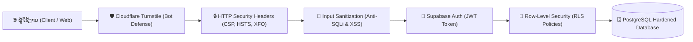

# ສ່ວນທີ 3: ຄວາມປອດໄພທາງໄຊເບີ ແລະ ການປ້ອງກັນຂໍ້ມູນ
## PART 3: CYBERSECURITY, ZERO-LEAK ARCHITECTURE & HARDENING SPECIFICATION

---

### 1. ບົດສະຫຼຸບຄວາມປອດໄພ (Executive Security Summary)

ລະບົບ **AvatrAutoService** ຖືກອອກແບບພາຍໃຕ້ມາດຕະຖານຄວາມປອດໄພ **Zero-Trust Architecture** ແລະ **Zero-Leak Protection** ເພື່ອປ້ອງກັນຂໍ້ມູນລູກຄ້າ VIP, ຂໍ້ມູນການເງິນຂອງໂຊຣູມ, ແລະ ເອກະສານສັນຍາ ບໍ່ໃຫ້ຮົ່ວໄຫຼສູ່ສາທາລະນະ ຫຼື ຖືກໂຈມຕີຈາກຜູ້ບໍ່ຫວັງດີ:



---

### 2. ສະຖາປັດຕະຍະກຳ Zero-Leak (Zero-Leak Security Architecture)

#### 2.1 ການແຍກ Key ຢ່າງເດັດຂາດ (Strict Key Isolation)
- **Frontend ໄດ້ຮັບສະເພາະ Public Key:** ເວັບບຣາວເຊີຈະໄດ້ຮັບສະເພາະ `VITE_SUPABASE_ANON_KEY` ເຊິ່ງບໍ່ມີສິດຂ້າມ RLS
- **ຫ້າມ Secret Key ໃນ Frontend 100%:** ລະບົບມີຕົວກວດຈັບ **Active Runtime Safeguard Validator** (`assertSafeSupabaseEnv`) ໃນ [`src/backend/client.ts`](file:///home/pheuang01/Projects/AvatrAutoService/src/backend/client.ts):
  - ຖ້າມີການນຳເອົາ `service_role` (Secret Master Key) ມາໃສ່ໃນ `.env` ໂດຍບໍ່ຕັ້ງໃຈ, ລະບົບຈະ **ຢຸດການເຮັດວຽກທັນທີ (Halt Application)** ກ່ອນທີ່ຈະສົ່ງ Network Request ອອກໄປ
- **ການປົກປ້ອງ Git:** ໄຟລ໌ `.env`, `.env.local`, `.env.*.local` ແລະ Service Accounts ທັງໝົດຖືກລະບຸໃນ `.gitignore` ຢ່າງຮັດກຸມ ບໍ່ມີການ Commit ຂຶ້ນ Git Repository

---

### 3. ຕາຕະລາງຄວບຄຸມສິດ Row-Level Security (RLS Policy Matrix)

ທຸກໆຕາຕະລາງໃນ Schema `public` ຖືກເປີດໃຊ້ງານ RLS (`ALTER TABLE ... ENABLE ROW LEVEL SECURITY;`):

| ຊື່ຕາຕະລາງ (Table) | ຜູ້ໃຊ້ທົ່ວໄປ (Anon / Public) | ພະນັກງານ (Authenticated Staff) | ຜູ້ດູແລລະບົບ (Admin) | ຜູ້ດູແລສູງສຸດ (Super Admin) |
| :--- | :---: | :---: | :---: | :---: |
| `staff_profiles` | ❌ ບໍ່ມີສິດ | 👁️ ອ່ານໄດ້ສະເພາະ Profile ຕົນເອງ | 👁️ ອ່ານທຸກຄົນ / ແກ້ໄຂໄດ້ | ⚡ ຈັດການໄດ້ 100% |
| `staff_roles` | ❌ ບໍ່ມີສິດ | 👁️ ອ່ານໄດ້ | 👁️ ອ່ານໄດ້ | ⚡ ແກ້ໄຂ ແລະ ສ້າງສິດໄດ້ |
| `vehicle_models` | 👁️ ອ່ານໄດ້ (Catalog) | 👁️ ອ່ານໄດ້ | ✏️ ເພີ່ມ/ແກ້ໄຂລຸ້ນລົດ | ⚡ ລຶບລຸ້ນລົດໄດ້ |
| `vehicles` (Inventory) | ❌ ບໍ່ມີສິດ | 👁️ ອ່ານສະຕັອກ / ກວດ PDI | ✏️ ຮັບລົດເຂົ້າ / ແກ້ໄຂສະຕັອກ | ⚡ ຈັດການໄດ້ 100% |
| `customers` | ❌ ບໍ່ມີສິດ | 👁️ ອ່ານ / ສ້າງ Lead / ອອກເອກະສານ | ✏️ ແກ້ໄຂຂໍ້ມູນລູກຄ້າ | ⚡ ລຶບລູກຄ້າໄດ້ |
| `bills` | ❌ ບໍ່ມີສິດ | 👁️ ອ່ານບິນ / ອອກບິນຂາຍ | 👁️ ອ່ານລາຍງານການເງິນ | ⚡ ລຶບ/ຍົກເລີກບິນຜ່ານ RPC |
| `bill_items` | ❌ ບໍ່ມີສິດ | 👁️ ອ່ານ / ສ້າງລາຍການບິນ | 👁️ ອ່ານໄດ້ | ⚡ ລຶບລາຍການໄດ້ |
| `stock_movements` | ❌ ບໍ່ມີສິດ | 👁️ ອ່ານປະຫວັດສາງ | 👁️ ອ່ານໄດ້ | ⚡ ຈັດການໄດ້ |
| `dealership_settings`| 👁️ ອ່ານ QR ແລະ ບັນຊີ | 👁️ ອ່ານໄດ້ | 👁️ ອ່ານໄດ້ | ⚡ ອັບໂຫຼດ QR ແລະ ປ່ຽນບັນຊີ |
| `service_appointments`| ❌ ບໍ່ມີສິດ | 👁️ ອ່ານ / ອັບເດດສະຖານະສ້ອມ | ✏️ ມອບໝາຍວຽກຊ່າງ | ⚡ ລຶບນັດໝາຍໄດ້ |
| `test_drives` | ❌ ບໍ່ມີສິດ | 👁️ ອ່ານ / ບັນທຶກການຂັບຂີ່ | ✏️ ຈັດການຕາຕະລາງ | ⚡ ລຶບນັດໝາຍໄດ້ |

---

### 4. ລະບົບຄວບຄຸມສິດ Role-Based Access Control (RBAC)

ລະບົບແບ່ງແຍກບົດບາດໜ້າທີ່ອອກເປັນ 5 ລະດັບຢ່າງຊັດເຈນ (Principle of Least Privilege):

1. **`super_admin` (Master Authority):**
   - ສິດສູງສຸດໃນລະບົບ: ອັບໂຫຼດ QR Code ການເງິນຂອງບໍລິສັດ, ອະນຸມັດ ແລະ ແຕ່ງຕັ້ງ Roles, ລຶບບິນທີ່ຜິດພາດຜ່ານ Secure RPC, ແລະ ລຶບຂໍ້ມູນຫຼັກ
2. **`admin` / `manager` (Branch Manager):**
   - ຄຸ້ມຄອງສາງລົດ, ຮັບລົດເຂົ້າສາງ (Stock-In), ເບິ່ງລາຍງານຍອດຂາຍລວມ, ຈັດການຂໍ້ມູນລູກຄ້າ ແລະ ຄ່າງວດ
3. **`sales` (Sales Consultant):**
   - ເຂົ້າເຖິງລະບົບ POS ອອກບິນ, ດຶງຂໍ້ມູນລົດໃນ Catalog, ສ້າງສັນຍາຈອງລົດ, ພິມເອກະສານ A4 ທັງ 5 ສະບັບ, ແລະ ສົ່ງຂໍ້ຄວາມ WhatsApp
4. **`technician` (PDI & Service Engineer):**
   - ເຂົ້າເຖິງສະເພາະການກວດສະພາບລົດ (PDI Status), ບັນທຶກສຸຂະພາບແບັດເຕີຣີ (Battery Health), ແລະ ຄຸ້ມຄອງໃບສ້ອມແປງ
5. **`general_user` (Pending / Read-Only):**
   - ຜູ້ໃຊ້ລົງທະບຽນໃໝ່ທີ່ຍັງລໍຖ້າການອະນຸມັດສິດຈາກ Admin ບໍ່ສາມາດເຂົ້າເຖິງຂໍ້ມູນການເງິນ ຫຼື ສະຕັອກໄດ້

---

### 5. ການປ້ອງກັນ Function Injection (`SECURITY DEFINER` Hardening)

ໃນຟັງຊັນ PostgreSQL ລະດັບສູງ ເຊັ່ນ `record_vehicle_bill` ແລະ `delete_vehicle_bill` ໄດ້ມີການປັບປຸງຄວາມປອດໄພດັ່ງນີ້:

- **ກຳນົດ Fixed Search Path:**
  ```sql
  ALTER FUNCTION public.record_vehicle_bill(...) SET search_path = public;
  ALTER FUNCTION public.delete_vehicle_bill(...) SET search_path = public;
  ```
  *ເຫດຜົນ:* ເພື່ອປ້ອງກັນການໂຈມຕີແບບ **Search Path Hijacking** ທີ່ຜູ້ໂຈມຕີສ້າງ Schema ຊ້ອນແລ້ວດັກຈັບສິດ Admin
- **Internal Role Check:**
  ກ່ອນຈະດຳເນີນການລຶບບິນ ຟັງຊັນຈະດຶງ `auth.uid()` ໄປກວດສອບກັບຕາຕະລາງ `staff_profiles` ໂດຍກົງ ວ່າຜູ້ຮ້ອງຂໍມີ Role ເປັນ `'super_admin'` ແທ້ຫຼືບໍ່ ຫາກບໍ່ແມ່ນຈະ Throw Exception ທັນທີ

---

### 6. ຄວາມປອດໄພລະດັບເຄືອຂ່າຍ ແລະ Web Headers (Network & Edge Defense)

#### 6.1 Cloudflare Turnstile (Bot & Anti-Abuse)
- ຕິດຕັ້ງ Widget Cloudflare Turnstile ທີ່ໜ້າ Login ([`TurnstileWidget.tsx`](file:///home/pheuang01/Projects/AvatrAutoService/src/components/common/TurnstileWidget.tsx)) ເພື່ອປ້ອງກັນການຍິງ Brute-Force Password ແລະ Bot Credential Stuffing

#### 6.2 Strict HTTP Security Headers (Netlify Production Config)
ໃນໄຟລ໌ [`netlify.toml`](file:///home/pheuang01/Projects/AvatrAutoService/netlify.toml) ໄດ້ກຳນົດ Security Headers ມາດຕະຖານ A+ Rating:

```toml
[[headers]]
  for = "/*"
  [headers.values]
    X-Frame-Options = "DENY"
    X-XSS-Protection = "1; mode=block"
    X-Content-Type-Options = "nosniff"
    Referrer-Policy = "strict-origin-when-cross-origin"
    Strict-Transport-Security = "max-age=31536000; includeSubDomains; preload"
    Permissions-Policy = "camera=(), microphone=(), geolocation=()"
    Content-Security-Policy = "default-src 'self'; connect-src 'self' https://*.supabase.co wss://*.supabase.co https://challenges.cloudflare.com; script-src 'self' 'unsafe-inline' https://challenges.cloudflare.com; style-src 'self' 'unsafe-inline' https://fonts.googleapis.com; font-src 'self' https://fonts.gstatic.com; img-src 'self' data: https: blob:;"
```

- **X-Frame-Options: DENY:** ປ້ອງກັນການນຳເວັບໄປໃສ່ໃນ `<iframe>` (Anti-Clickjacking)
- **X-Content-Type-Options: nosniff:** ປ້ອງກັນບຣາວເຊີແປງປະເພດໄຟລ໌ເອງ (Anti-MIME Confusion)
- **HSTS:** ບັງຄັບການເຊື່ອມຕໍ່ຜ່ານ HTTPS ຕະຫຼອດ 1 ປີ

---

### 7. ການກວດສອບຄວາມປອດໄພຕາມມາດຕະຖານ OWASP Top 10

| ລຳດັບ OWASP | ຊື່ຄວາມສ່ຽງ (Vulnerability Category) | ວິທີການປ້ອງກັນໃນລະບົບ AvatrAutoService | ສະຖານະ |
| :---: | :--- | :--- | :---: |
| **A01:2021** | **Broken Access Control** | ເປີດ RLS 100% ທຸກຕາຕະລາງ, ກວດສອບສິດ RBAC ໃນລະດັບ Row ແລະ Function | 🛡️ ປ້ອງກັນສົມບູນ |
| **A02:2021** | **Cryptographic Failures** | ບັງຄັບ HTTPS/HSTS, ລະຫັດຜ່ານຖືກ Hash ດ້ວຍ bcrypt/Argon2 ໂດຍ Supabase Auth | 🛡️ ປ້ອງກັນສົມບູນ |
| **A03:2021** | **Injection (SQLi & XSS)** | Parameterized Queries ຜ່ານ Supabase Client, ມີ Input Sanitization ໃນ [`security.ts`](file:///home/pheuang01/Projects/AvatrAutoService/src/utils/security.ts) | 🛡️ ປ້ອງກັນສົມບູນ |
| **A04:2021** | **Insecure Design** | ອອກແບບລະບົບຕັດສະຕັອກແບບ Atomic Transaction, ປ້ອງກັນ Race Condition | 🛡️ ປ້ອງກັນສົມບູນ |
| **A05:2021** | **Security Misconfiguration** | ປິດ Public Directory Listing, ຕັ້ງ Security Headers ຄົບຖ້ວນ, ລັອກ Search Path | 🛡️ ປ້ອງກັນສົມບູນ |
| **A06:2021** | **Vulnerable Components** | ອັບເດດ React 19, Vite 6, ຕັດ Library ທີ່ບໍ່ຈຳເປັນ (drop unused motion) | 🛡️ ປ້ອງກັນສົມບູນ |
| **A07:2021** | **Auth & Identification Failures** | ປ້ອງກັນ Brute-force ດ້ວຍ Cloudflare Turnstile, ມີ session timeout | 🛡️ ປ້ອງກັນສົມບູນ |
| **A08:2021** | **Software & Data Integrity Failures** | ຄວບຄຸມການປ່ຽນແປງ QR Code ການເງິນສະເພາະ Super Admin ເທົ່ານັ້ນ | 🛡️ ປ້ອງກັນສົມບູນ |
| **A09:2021** | **Security Logging & Monitoring** | ບັນທຶກ `stock_movements`, ວັນທີເວລາອອກບິນ, ຜູ້ບັນທຶກ ແລະ ປະຫວັດເຂົ້າລະບົບ | 🛡️ ປ້ອງກັນສົມບູນ |
| **A10:2021** | **Server-Side Request Forgery (SSRF)**| ບໍ່ມີ Endpoint ທີ່ເປີດໃຫ້ User ສົ່ງ URL ໃຫ້ Server ດາວໂຫຼດໂດຍກົງ | 🛡️ ປ້ອງກັນສົມບູນ |

---

### 8. ລາຍການກວດສອບຄວາມປອດໄພກ່ອນສົ່ງມອບ (Cybersecurity Audit Checklist)

- [x] ບໍ່ມີ Secret Key (`service_role`) ປາກົດຢູ່ໃນ Frontend Source Code ຫຼື Bundle Build
- [x] ໄຟລ໌ `.env` ຖືກປົກປ້ອງດ້ວຍ `.gitignore` ບໍ່ຫຼຸດຂຶ້ນ Git
- [x] ທຸກໆຕາຕະລາງໃນ PostgreSQL ເປີດໃຊ້ງານ Row-Level Security (RLS)
- [x] ຟັງຊັນ `record_vehicle_bill` ແລະ `delete_vehicle_bill` ລັອກ `search_path = public`
- [x] ລະບົບຕັ້ງຄ່າ Security Headers (CSP, HSTS, XFO) ຄົບຖ້ວນໃນ `netlify.toml`
- [x] ລະບົບປ້ອງກັນ Bot ດ້ວຍ Cloudflare Turnstile ພ້ອມໃຊ້ງານ
- [x] ມີໂມດູນ Sanitize ຂໍ້ມູນ VIN, ເບີໂທ, ແລະ ຈຳນວນເງິນກ່ອນບັນທຶກລົງ Database
