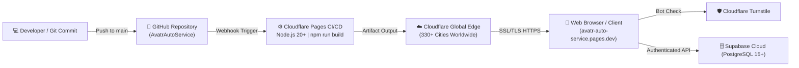
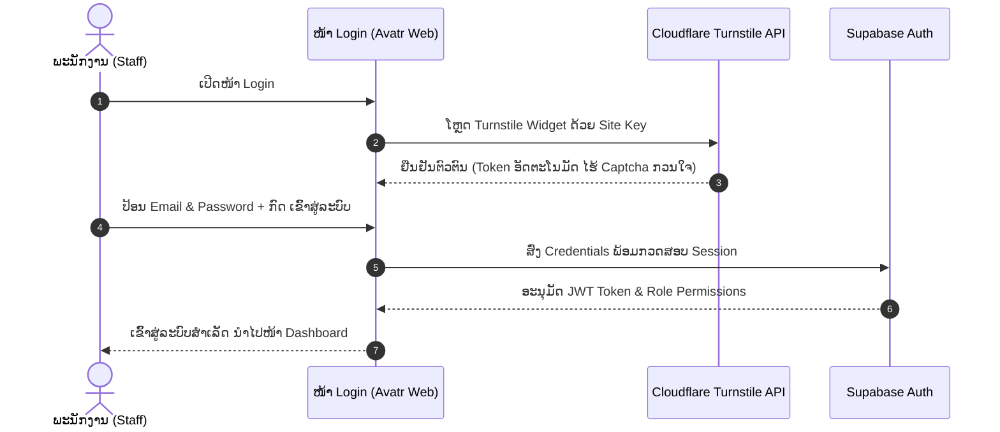

# ຄູ່ມືການຕິດຕັ້ງ ແລະ Deploy ຜ່ານ Cloudflare Pages ສະບັບລະອຽດ
## CLOUDFLARE PAGES PRODUCTION DEPLOYMENT & EDGE INFRASTRUCTURE SOP
### ໂຄງການ: ລະບົບຄຸ້ມຄອງສູນບໍລິການ ແລະ ໂຊຣູມລົດໄຟຟ້າ AVATR (AvatrAutoService Laos)
**ສະບັບປັບປຸງ:** `v1.4.0 (Enterprise Edition)`  
**ວັນທີ:** 14 ຕຸລາ (October) 2026  
**ສະຖານະ:** ພ້ອມນຳໃຊ້ງານຈິງ (Production Ready)

---

## 1. ບົດສະຫຼຸບພາບລວມ (Executive Overview)

ເອກະສານສະບັບນີ້ຖືກສ້າງຂຶ້ນເພື່ອເປັນ **Standard Operating Procedure (SOP)** ສຳລັບວິສະວະກອນ IT, DevOps, ແລະ ຜູ້ຄຸ້ມຄອງລະບົບຂອງ **ບໍລິສັດ ລາວທານີ ກົນຈັກໜັກ ຈຳກັດຜູ້ດຽວ (Laothani Tractor Sole Co., Ltd)** ໃນການນຳສົ່ງລະບົບ (Deploy) ເວັບແອັບພລິເຄຊັນ **AvatrAutoService** ຂຶ້ນສູ່ **Cloudflare Pages Global Edge Network** ຢ່າງຖືກຕ້ອງ, ປອດໄພ, ແລະ ສົມບູນ 100%.



---

## 2. ຕຳແໜ່ງໄຟລ໌ ແລະ Path ສຳຄັນໃນລະບົບ (Repository File Map)

> [!IMPORTANT]
> ຜູ້ໃຊ້ງານ ຫຼື ວິສະວະກອນສາມາດອ້າງອີງ Path ຂອງໄຟລ໌ທີ່ກ່ຽວຂ້ອງກັບການ Deploy ໄດ້ໂດຍກົງຕາມຕາຕະລາງລຸ່ມນີ້:

| ລຳດັບ | ໄຟລ໌ / ໂຟລເດີ (File Path) | ໜ້າທີ່ ແລະ ຄວາມສຳຄັນໃນການ Deploy |
| :---: | :--- | :--- |
| 1 | [`public/_headers`](file:///home/pheuang01/Projects/AvatrAutoService/public/_headers) | **Security Headers:** ບັນຈຸຄ່າ Content-Security-Policy (CSP), HSTS, X-Frame-Options: DENY, Cache-Control ມາດຕະฐาน Cloudflare A+ |
| 2 | [`public/_redirects`](file:///home/pheuang01/Projects/AvatrAutoService/public/_redirects) | **SPA Fallback Routing:** ກຳນົດ `/* /index.html 200` ເພື່ອປ້ອງກັນບໍ່ໃຫ້ເກີດ Error 404 ເມື່ອຜູ້ໃຊ້ Refresh ໜ້າຕ່າງໆ |
| 3 | [`.env.example`](file:///home/pheuang01/Projects/AvatrAutoService/.env.example) | **Env Template:** ແມ່ແບບຕົວແປສະພາບແວດລ້ອມທີ່ຕ້ອງນຳໄປປ້ອນໃນ Cloudflare Pages Settings |
| 4 | [`package.json`](file:///home/pheuang01/Projects/AvatrAutoService/package.json) | **Build & Scripts:** ບັນຈຸຄຳສັ່ງ `npm run build` (`vite build`) ແລະ `npm run lint` (`tsc --noEmit`) |
| 5 | [`vite.config.ts`](file:///home/pheuang01/Projects/AvatrAutoService/vite.config.ts) | **Vite Config:** ໂຄງສ້າງການ Bundle, Chunking ແລະ Static Asset Handling |
| 6 | [`dist/`](file:///home/pheuang01/Projects/AvatrAutoService/dist) | **Output Directory:** ໂຟລເດີຜົນລັບຫຼັງຈາກ Build ທີ່ Cloudflare Pages ຈະດຶງໄປກະຈາຍເທິງ Edge CDN |
| 7 | [`src/backend/client.ts`](file:///home/pheuang01/Projects/AvatrAutoService/src/backend/client.ts) | **Zero-Leak Guard:** ລະບົບກວດສອບຄວາມປອດໄພອັດຕະໂນມັດ ປ້ອງກັນບໍ່ໃຫ້ Service Role Key ຮົ່ວໄຫຼ |
| 8 | [`src/components/common/TurnstileWidget.tsx`](file:///home/pheuang01/Projects/AvatrAutoService/src/components/common/TurnstileWidget.tsx) | **Bot Guard Widget:** ໂມດູນ Cloudflare Turnstile ປ້ອງກັນ Bot ທີ່ໜ້າເຂົ້າສູ່ລະບົບ (Login) |

---

## 3. ສິ່ງທີ່ຕ້ອງກຽມກ່ອນເລີ່ມ Deploy (Prerequisites Checklist)

- [x] **ບັນຊີ Cloudflare:** ມີບັນຊີ [Cloudflare Dashboard](https://dash.cloudflare.com/) ຂອງບໍລິສັດ
- [x] **Git Repository:** Source code ຖືກ Push ຂຶ້ນ GitHub Branch `main` ຮຽບຮ້ອຍແລ້ວ
- [x] **Supabase Project Credentials (ຂໍ້ມູນເຊື່ອມຕໍ່ຖານຂໍ້ມູນ ແລະ ຫຼັງບ້ານ):**
  - **`VITE_SUPABASE_URL`:** URL ຫຼັກສຳລັບເຊື່ອມຕໍ່ລະບົບໜ້າເວັບ (Frontend) ເຂົ້າກັບ Supabase API Gateway ທັງໝົດ ເຊິ່ງຄວບຄຸມ:
    - ຖານຂໍ້ມູນຫຼັກ **PostgreSQL 15+ Core Tables**
    - ລະບົບຢັ້ງຢືນຕົວຕົນ **Supabase Auth (JWT)**
    - ລະບົບ Cloud Storage (**dealership-assets** & **payment-slips**)
    - ຟັງຊັນຫຼັງບ້ານ **Supabase Edge Functions** (`create-staff`, `manage-staff`)
  - **`VITE_SUPABASE_ANON_KEY`:** Public Anon Key ສຳລັບ Frontend ໃຊ້ຮຽກ API ຢ່າງປອດໄພ ພາຍໃຕ້ການຄວບຄຸມຂອງ **Row-Level Security (RLS)**
  - *ວິທີເອົາຄ່າຈາກ Supabase:*
    ```text
    Supabase Dashboard (https://supabase.com/dashboard)
     └── Project Settings (ໄອຄອນຟັນເຟືອງມຸມລຸ່ມຊ້າຍ)
          └── API
               ├── Project URL (ຄັດລອກໃສ່ VITE_SUPABASE_URL)
               └── Project API keys -> anon public (ຄັດລອກໃສ່ VITE_SUPABASE_ANON_KEY)
    ```
- [x] **Cloudflare Turnstile Site Key (ບັອດກາດໜ້າ Login):**
  - **`VITE_TURNSTILE_SITE_KEY`:** Site Key ສຳລັບປ້ອງກັນ Brute-force ທີ່ໜ້າ Login
- [x] **ການເຊື່ອມຕໍ່ລະບົບຫຼັງບ້ານ Edge Functions:**
  - ໂມດູນຈັດການຜູ້ໃຊ້ງານລະດັບ Admin (`supabase/functions/create-staff` ແລະ `manage-staff`) ເຮັດວຽກເທິງ Supabase Deno Edge Runtime ຝັ່ງ Server ເຊິ່ງໄດ້ຮັບ `SUPABASE_SERVICE_ROLE_KEY` ຈາກລະບົບພາຍໃນ Supabase ໂດຍກົງຢູ່ແລ້ວ ຈຶ່ງ**ບໍ່ຈຳເປັນ ແລະ ຫ້າມ**ເອົາ Service Role Key ມາໃສ່ໃນ `.env` ຂອງໜ້າເວັບ.

> [!CAUTION]
> **ຂໍ້ຄວນລະວັງລະດັບສູງສຸດ (Zero-Leak Policy):**
> ຫ້າມນຳເອົາ `SUPABASE_SERVICE_ROLE_KEY` ໄປໃສ່ໃນ Environment Variables ຂອງ Cloudflare Pages ເປັນອັນຂາດ! ເພາະ Cloudflare Pages ເປັນ Frontend Client-Side Environment ເຊິ່ງຄ່າຕົວແປ `VITE_*` ຈະຖືກ Bundle ເຂົ້າໃນໄຟລ໌ JavaScript ທີ່ Client ສາມາດເຫັນໄດ້.

---

### 3.1 ຄູ່ມືດ່ວນສຳລັບຜູ້ທີ່ບໍ່ຊຳນານເມນູໄອທີ: "ຫຼັງບ້ານ (Backend) ຢູ່ໃສ ແລະ ເອົາຄ່າແນວໃດບໍ່ໃຫ້ຫຼົງ?"

> [!NOTE]
> **ຄຳຖາມທີ່ພົບເລື້ອຍ:** *"ຫຼັງບ້ານ (Backend) ຢູ່ໃສ? ຕ້ອງໄປເປີດ Server Node.js / Express ແຍກອີກບໍ່? ເປັນຫຍັງຫາເມນູ Backend ໃນ Supabase ບໍ່ເຫັນ?"*  
> **ຄຳຕອບ:** ລະບົບນີ້ໃຊ້ສະຖາປັດຕະຍະກຳ Cloud BaaS **ບໍ່ຕ້ອງມີ Server ຫຼັງບ້ານແຍກຕ່າງຫາກແມ່ນແຕ່ເຄື່ອງດຽວ!** ລະບົບຫຼັງບ້ານ (Backend API, Login, Auth, Edge Functions) ແລະ ຖານຂໍ້ມູນ (Database) **ລວມຢູ່ໃນ Supabase Cloud ທັງໝົດແລ້ວ**.

#### ຂັ້ນຕອນການຄລິກເອົາຄ່າໃນ Supabase ແບບຈັບມືເຮັດ (Click-by-Click Guide):

```text
ຂັ້ນທີ 1: ເປີດເວັບ https://supabase.com/dashboard ແລ້ວຄລິກເຂົ້າ Project ຂອງທ່ານ
  │
  └── ຂັ້ນທີ 2: ແນມເບິ່ງເມນູ "ຊ້າຍລຸ່ມສຸດ" ຫາໄອຄອນ ⚙️ Project Settings (ຮູບຟັນເຟືອງ) ➔ ຄລິກເລີຍ!
        │
        └── ຂັ້ນທີ 3: ໃນເມນູຍ່ອຍດ້ານຊ້າຍ ພາຍໃຕ້ໝວດ Configuration ➔ ຄລິກເລືອກ "API"
              │
              ├── 📋 ຈຸດທີ 1: ແນມຫາກ່ອງ "Project URL" ➔ ກົດປຸ່ມ Copy 
              │    (ນີ້ຄື URL ຫຼັງບ້ານ & ຖານຂໍ້ມູນ ➔ ນຳໄປໃສ່ VITE_SUPABASE_URL)
              │
              └── 📋 ຈຸດທີ 2: ເລື່ອນລົງມາກ່ອງ "Project API keys" ➔ ແນມຫາແຖວ "anon" "public" ➔ ກົດປຸ່ມ Copy
                   (ນີ້ຄື ກຸນແຈເຊື່ອມຕໍ່ຫຼັງບ້ານ ➔ ນຳໄປໃສ່ VITE_SUPABASE_ANON_KEY)
```

#### ຂັ້ນຕອນການເອົາຄ່າໄປວາງໃນ Cloudflare Pages ແບບຈັບມືເຮັດ:

```text
ຂັ້ນທີ 1: ເປີດເວັບ https://dash.cloudflare.com/
  │
  └── ຂັ້ນທີ 2: ເມນູດ້ານຊ້າຍ ➔ ຄລິກ "Workers & Pages"
        │
        └── ຂັ້ນທີ 3: ຄລິກເລືອກ Project "avatr-auto-service"
              │
              └── ຂັ້ນທີ 4: ແຖບເມນູດ້ານເທິງ ➔ ຄລິກ "Settings"
                    │
                    └── ຂັ້ນທີ 5: ເມນູດ້ານຊ້າຍ ➔ ຄລິກ "Environment variables"
                          │
                          └── ຂັ້ນທີ 6: ຫົວຂໍ້ Production ➔ ກົດປຸ່ມ "Add variable" (ຫຼື "Edit variables")
                                │
                                ├── ຊ່ອງ Variable name: VITE_SUPABASE_URL
                                │   ຊ່ອງ Value: [ວາງ Project URL ທີ່ກັອບມາຈາກ Supabase]
                                │
                                └── ຊ່ອງ Variable name: VITE_SUPABASE_ANON_KEY
                                    ຊ່ອງ Value: [ວາງ anon public key ທີ່ກັອບມາຈາກ Supabase]
                                │
                                └── ກົດປຸ່ມ "Save" (ບັນທຶກ) ➔ ສຳເລັດຮຽບຮ້ອຍ!
```

---

## 4. ວິທີທີ 1: ການ Deploy ຜ່ານ Cloudflare Dashboard GUI (ແນະນຳສຳລັບ Production)

ວິທີນີ້ເປັນວິທີມາດຕະຖານທີ່ສະດວກທີ່ສຸດ ເພາະ Cloudflare ຈະເຊື່ອມຕໍ່ກັບ Git ແລະ ເຮັດການ Auto-Deploy ທຸກຄັ້ງທີ່ມີການ Commit ໃໝ່.

### ຂັ້ນຕອນທີ 1: ເຂົ້າສູ່ເມນູ Pages
1. ເຂົ້າສູ່ລະບົບທີ່ [https://dash.cloudflare.com/](https://dash.cloudflare.com/)
2. ໃນແຖບເມນູດ້ານຊ້າຍ ໃຫ້ຄລິກທີ່ **Workers & Pages**
3. ເລືອກແຖບ **Overview** ແລ້ວກົດປຸ່ມ **Create application** (ຫຼື **Create**)
4. ເລືອກແຖບ **Pages** ແລ້ວກົດປຸ່ມ **Connect to Git**

```text
[Cloudflare Dashboard]
 └── Workers & Pages
      └── Overview
           └── Create application
                └── Pages
                     └── [Connect to Git]
```

### ຂັ້ນຕອນທີ 2: ເຊື່ອມຕໍ່ GitHub Repository
1. ເລືອກບັນຊີ **GitHub** ທີ່ເກັບ Source Code ຂອງໂຄງການ
2. ຄົ້ນຫາ ແລະ ເລືອກ Repository: `AvatrAutoService`
3. ກົດປຸ່ມ **Begin setup**

### ขັ້ນຕອນທີ 3: ຕັ້ງຄ່າ Build Settings (Build Configuration)
ປ້ອນຂໍ້ມູນການຕັ້ງຄ່າຕາມຄ່າທີ່ກຳນົດໄວ້ດັ່ງນີ້:

| ຊ່ອງຕັ້ງຄ່າ (Configuration Field) | ຄ່າທີ່ຕ້ອງປ້ອນ (Value to Enter) | ຄຳອະທິບາຍ (Description) |
| :--- | :--- | :--- |
| **Project name** | `avatr-auto-service` | ຊື່ໂປຣເຈັກ (ຈະຖືກນຳໄປສ້າງ Subdomain: `.pages.dev`) |
| **Production branch** | `main` | Branch ຫຼັກສຳລັບ Production |
| **Framework preset** | `Vite` | ເລືອກ Preset ເປັນ Vite |
| **Build command** | `npm run build` | ຄຳສັ່ງ Build ມາດຕະຖານຂອງໂຄງການ |
| **Build output directory** | `dist` | ໂຟລເດີທີ່ບັນຈຸໄຟລ໌ Output ຫຼັງ Build |
| **Root directory** | *(ປະວ່າງ ຫຼື ໃສ່ `/`)* | ໂຟລເດີຮາກຂອງໂຄງການ |

### ขັ້ນຕອນທີ 4: ຕັ້ງຄ່າ Environment Variables
ກົດຂະຫຍາຍຫົວຂໍ້ **Environment variables (advanced)** ແລ້ວເພີ່ມຕົວແປດັ່ງນີ້:

```env
NODE_VERSION = 20
VITE_SUPABASE_URL = https://your-project-id.supabase.co
VITE_SUPABASE_ANON_KEY = eyJhbGciOiJIUzI1NiIsInR5cCI6IkpXVCJ9...
VITE_TURNSTILE_SITE_KEY = 0x4AAAAAAA... (Site Key ຈາກ Cloudflare Turnstile)
VITE_APP_ENV = production
```

> [!TIP]
> ການກຳນົດ `NODE_VERSION = 20` ຫຼື `22` ມີຄວາມສຳຄັນຫຼາຍ ເພື່ອໃຫ້ Cloudflare Pages Runner ໃຊ້ Node.js ເວີຊັນທີ່ຮອງຮັບ Vite 6 ແລະ React 19 ຢ່າງສົມບູນ.

### ขັ້ນຕອນທີ 5: ກົດ Save and Deploy
1. ກວດສອບຄວາມຖືກຕ້ອງແລ້ວກົດປຸ່ມ **Save and Deploy**
2. Cloudflare Pages ຈະເລີ່ມດຳເນີນການ:
   - Cloned repository
   - ຕິດຕັ້ງ dependencies (`npm install`)
   - ຮັນຄຳສັ່ງ Build (`npm run build`)
   - ກະຈາຍໄຟລ໌ຈາກ `dist/` ໄປຍັງ Edge Servers ທົ່ວໂລກ
3. ເມື່ອສຳເລັດ ລະບົບຈະສະແດງຂໍ້ຄວາມ **Success! Your site is deployed!** ພ້ອມລິ້ງ URL ທາງການ:
   👉 **`https://avatr-auto-service.pages.dev`**

---

## 5. ວິທີທີ 2: ການ Deploy ຜ່ານ Wrangler CLI (ສຳລັບ DevOps & Direct Upload)

ຖ້າຕ້ອງການ Deploy ໂດຍກົງຜ່ານ Terminal ໂດຍບໍ່ຕ້ອງຜ່ານ Git Webhook ສາມາດໃຊ້ **Cloudflare Wrangler CLI** ໄດ້ດັ່ງນີ້:

### ຂັ້ນຕອນທີ 1: ທົດສອບ Build ພາຍໃນເຄື່ອງ (Local Build Verification)
ເປີດ Terminal ທີ່ໂຟລເດີໂຄງການ `/home/pheuang01/Projects/AvatrAutoService`:

```bash
# 1. ກວດສອບ Type Safety
npm run lint

# 2. ສ້າງ Production Bundle
npm run build
```

ກວດສອບວ່າໂຟລເດີ [`dist/`](file:///home/pheuang01/Projects/AvatrAutoService/dist) ຖືກສ້າງຂຶ້ນ ແລະ ມີໄຟລ໌ `_headers` ແລະ `_redirects` ຢູ່ພາຍໃນ:

```bash
ls -la dist/
```

### ຂັ້ນຕອນທີ 2: Login ເຂົ້າ Cloudflare ຜ່ານ Wrangler
```bash
npx wrangler login
```
*(ລະບົບຈະເປີດ Browser ຂຶ້ນມາໃຫ້ກົດ Authorize ເພື່ອຢືນຢັນສິດ)*

### ຂັ້ນຕອນທີ 3: ສັ່ງ Deploy ໂຟລເດີ dist
```bash
npx wrangler pages deploy dist --project-name=avatr-auto-service --branch=main
```

ເມື່ອ Deploy ສຳເລັດ Terminal ຈະສະແດງຜົນ URL:
```text
✨ Success! Uploaded 10 files (2.45 sec)
✨ Deployment complete! Take a peek over at https://avatr-auto-service.pages.dev
```

---

## 6. ຂັ້ນຕອນການຕັ້ງຄ່າ Cloudflare Turnstile (Bot Defense Setup)

ເພື່ອໃຫ້ລະບົບປ້ອງກັນ Bot ແລະ Brute-Force Password ໃນໜ້າ Login ເຮັດວຽກໄດ້ຢ່າງສົມບູນ ໃຫ້ຕັ້ງຄ່າດັ່ງນີ້:



1. ເຂົ້າສູ່ [Cloudflare Dashboard](https://dash.cloudflare.com/)
2. ໃນເມນູດ້ານຊ້າຍ ເລືອກ **Turnstile**
3. ກົດປຸ່ມ **Add site** (ຫຼື **Add Widget**)
4. ຕັ້ງຄ່າ Widget:
   - **Site name:** `AvatrAutoService Production`
   - **Domain:**
     - `avatr-auto-service.pages.dev` *(Subdomain ຂອງ Cloudflare Pages)*
     - `localhost` *(ສຳລັບການທົດສອບພາຍໃນເຄື່ອງ Dev)*
     - `127.0.0.1`
   - **Widget Mode:** ເລືອກ **Managed** *(ແນະນຳ - ລະບົບຈະກວດສອບແບບ Interactive ເມື່ອມີພຶດຕິກຳໜ້າສົງໄສ)*
5. ກົດ **Create**
6. ຄັດລອກເອົາ **Site Key** ມາກຳນົດໃສ່ໃນ Cloudflare Pages Environment Variables:
   - Key: `VITE_TURNSTILE_SITE_KEY`
   - Value: `0x4AAAAAAA...`

---

## 7. ລາຍການກວດສອບຫຼັງການ Deploy (Post-Deployment Verification Checklist)

ຫຼັງຈາກການ Deploy ສຳເລັດ ໃຫ້ວິສະວະກອນດຳເນີນການທົດສອບ 5 ຂໍ້ຫຼັກດັ່ງຕໍ່ໄປນີ້:

| ລ/ດ | ລາຍການທົດສອບ (Verification Task) | ວິທີການກວດສອບ (How to Verify) | ຜົນທີ່ຖືກຕ້ອງ (Expected Behavior) | ສະຖານະ |
| :---: | :--- | :--- | :--- | :---: |
| 1 | **ການເຂົ້າເຖິງຜ່ານ HTTPS** | ເປີດ `https://avatr-auto-service.pages.dev` | ເວັບໄຊໂຫຼດຂຶ້ນຢ່າງວ່ອງໄວ ມີກຸນແຈສີຂຽວ SSL/TLS 100% | [ ] ຜ່ານ |
| 2 | **ທົດສອບ SPA Routing & Refresh** | ກົດເຂົ້າໜ້າ `/inventory` ຫຼື `/customers` ແລ້ວກົດ **F5 (Refresh)** | ບໍ່ເກີດ Error 404 (ຍ້ອນມີ `_redirects` ຮອງຮັບ) | [ ] ຜ່ານ |
| 3 | **ທົດສອບ Security Headers** | ເປີດ DevTools (F12) > Network > ເລືອກ `index.html` > ເບິ່ງ Response Headers | ພົບຄ່າ `Strict-Transport-Security`, `X-Frame-Options: DENY`, `X-Content-Type-Options: nosniff` | [ ] ຜ່ານ |
| 4 | **ທົດສອບ Turnstile Bot Guard** | ເບິ່ງໜ້າ Login ພົບ Widget "Cloudflare Turnstile Verified" | ກວດສອບຜ່ານອັດຕະໂນມັດ ປຸ່ມເຂົ້າສູ່ລະບົບພ້ອມກົດ | [ ] ຜ່ານ |
| 5 | **ທົດສອບການດຶງຂໍ້ມູນ Supabase** | ລັອກອິນດ້ວຍບັນຊີພະນັກງານຕົວຈິງ | ດຶງລາຍການລົດ, ລາຍການຂາຍ ແລະ ສະຕັອກຂຶ້ນມາໄດ້ປົກກະຕິ | [ ] ຜ່ານ |

---

## 8. ຄູ່ມືແກ້ໄຂບັນຫາທີ່ພົບເລື້ອຍ (Troubleshooting Guide)

### ບັນຫາທີ 1: Refresh ໜ້າເວັບແລ້ວຂຶ້ນ "Page Not Found" (404 Error)
- **ສາເຫດ:** Single Page Application (SPA) ຕ້ອງການໃຫ້ Server ສົ່ງທຸກ Route ກັບມາຍັງ `index.html`
- **ວິທີແກ້ໄຂ:**
  1. ກວດສອບໄຟລ໌ [`public/_redirects`](file:///home/pheuang01/Projects/AvatrAutoService/public/_redirects) ວ່າຕ້ອງມີຂໍ້ຄວາມ:
     ```text
     /* /index.html 200
     ```
  2. ໝັ້ນໃຈວ່າຕອນ Build ໄຟລ໌ນີ້ຖືກ Copy ໄປໄວ້ໃນ `dist/_redirects`

### ບັນຫາທີ 2: Cloudflare Build ລົ້ມເຫຼວ (Build Failure / Node Mismatch)
- **ສາເຫດ:** Cloudflare Pages ຄ່າ Default ບາງຄັ້ງໃຊ້ Node.js ເວີຊັນເກົ່າ
- **ວິທີແກ້ໄຂ:**
  1. ເຂົ້າໄປທີ່ **Settings** > **Environment variables** ຂອງ Pages Project
  2. ເພີ່ມຕົວແປ: `NODE_VERSION` = `20`
  3. ກົດ **Retry deployment**

### ບັນຫາທີ 3: Turnstile ຂຶ້ນຂໍ້ຄວາມ "Domain not allowed"
- **ສາເຫດ:** ໂດເມນທີ່ເຂົ້າໃຊ້ງານຍັງບໍ່ໄດ້ຮັບການອະນຸຍາດໃນ Turnstile Config
- **ວິທີແກ້ໄຂ:**
  1. ເຂົ້າ Cloudflare Dashboard > **Turnstile** > ເລືອກ Widget
  2. ກົດ **Settings** ແລ້ວເພີ່ມໂດເມນ `avatr-auto-service.pages.dev` ເຂົ້າໃນລາຍການ **Domains**
  3. ກົດ **Save**

### ບັນຫາທີ 4: ຂໍ້ມູນບໍ່ໂຫຼດ ຫຼື ຂຶ້ນ Network Error ເວລາຮຽກ Supabase
- **ສາເຫດ:** ຕົວແປ `VITE_SUPABASE_URL` ຫຼື `VITE_SUPABASE_ANON_KEY` ບໍ່ຖືກຕ້ອງ ຫຼື ມີຊ່ອງວ່າງ (White-space) ຕິດມາ
- **ວິທີແກ້ໄຂ:**
  1. ກວດສອບຕົວແປໃນ **Cloudflare Pages Settings > Environment variables**
  2. ປຽບທຽບຄ່າກັບ [`.env.example`](file:///home/pheuang01/Projects/AvatrAutoService/.env.example) ໃຫ້ຖືກຕ້ອງຕົງກັນທຸກຕົວອັກສອນ
  3. ຫຼັງແກ້ໄຂ Environment Variables ແລ້ວ ຕ້ອງກົດ **Create new deployment** ທຸກຄັ້ງ ເພື່ອໃຫ້ Vite Re-bundle ຄ່າໃໝ່
