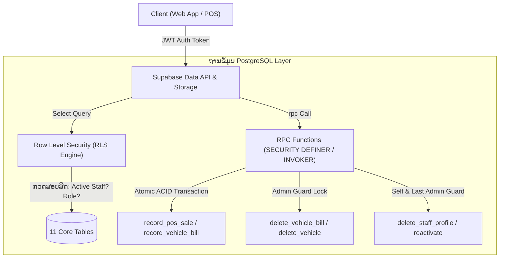

# ເອກະສານສົ່ງມອບງານ (Handover Documentation)
## ສະຖາປັດຕະຍະກຳຄວາມປອດໄພ: RPCs (Database Functions) ແລະ RLS Policies (Row Level Security)
**ໂຄງການ:** AVATR AUTO SERVICE LAOS (CRM & Showroom Management System)  
**ຖານຂໍ້ມູນ:** Supabase / PostgreSQL 15+  
**ພາສາ:** ພາສາລາວ (Lao Language)  
**ສະຖານະ:** Production Ready (ຜ່ານການກວດສອບຄວາມປອດໄພ ແລະ Audit ຄົບຖ້ວນ)

---

## 1. ບົດນຳ ແລະ ພາບລວມ (Overview & Architecture)

ລະບົບ Avatr Auto Service ຖືກອອກແບບມາຕາມມາດຕະຖານ **Enterprise Security** ໂດຍໃຊ້ຫຼັກການ **Defense-in-Depth (ການປ້ອງກັນຫຼາຍຊັ້ນ)** ເຊິ່ງບໍ່ໄດ້ເພິ່ງພາພຽງແຕ່ Frontend ໃນການກວດສອບສິດ ແຕ່ຄວບຄຸມຄວາມປອດໄພໂດຍກົງຢູ່ທີ່ຊັ້ນຖານຂໍ້ມູນ (Database Layer):

1. **Row Level Security (RLS):** ປ້ອງກັນການເຂົ້າເຖິງ, ອ່ານ, ແກ້ໄຂ ຫຼື ລົບຂໍ້ມູນໃນຕາຕະລາງ ໂດຍອ້າງອີງຕາມ Token ການລັອກອິນຂອງຜູ້ໃຊ້ (`auth.uid()`) ແລະ ສະຖານະການເປັນພະນັກງານ (`is_active_staff()`).
2. **Remote Procedure Calls (RPCs):** ທຸລະກຳຫຼັກ (Transactions) ທີ່ສຳຄັນ ເຊັ່ນ: ການຂາຍລົດ, ການຕັດສະຕ໋ອກ, ການລົບບິນ ແລະ ການຈັດການບັນຊີ ຈະບໍ່ເຮັດຜ່ານການ Update ຕາຕະລາງກົງໆຈາກ Client ແຕ່ຈະເຮັດຜ່ານ **Stored Procedures / Functions** ທີ່ເປັນ **Atomic Transaction** (ຖ້າຂັ້ນຕອນໃດໜຶ່ງຜິດພາດ ລະບົບຈະ Rollback ທັນທີ 100% ບໍ່ມີຂໍ້ມູນຄ້າງ).

---

## 2. ລາຍລະອຽດ RPCs ທັງໝົດໃນລະບົບ (Database Functions)

### 2.1 `record_pos_sale(p_customer jsonb, p_bill jsonb, p_item jsonb)`
- **ໜ້າທີ່:** ບັນທຶກການຂາຍລົດໜ້າຮ້ານ (POS) ແບບ **Atomic Transaction ຮອບດຽວຈົບ** ຄື: ບັນທຶກຂໍ້ມູນລູກຄ້າ (`customers`) + ອອກໃບບິນຂາຍ (`bills`) + ບັນທຶກລາຍການລົດໃນບິນ (`bill_items`) + ບັນທຶກປະຫວັດການເຄື່ອນໄຫວສະຕ໋ອກ (`stock_movements`) + ປັບສະຖານະສະຕ໋ອກລົດເປັນ `sold` (`vehicles`).
- **ຄວາມປອດໄພ:**
  - ຮຽກຮ້ອງສິດ: ຕ້ອງເປັນພະນັກງານສະຖານະ `active` ແລະ ມີສິດ `canDeductPOS` (`sales`, `admin`, `super_admin`).
  - ຖ້າລົດຖືກຂາຍໄປກ່ອນໜ້ານີ້ແລ້ວ (Double-spend) ລະບົບຈະ Reject ທັນທີພ້ອມ Rollback.
  - ຜູກມັດ `assigned_to` ແລະ `recorded_by` ເຂົ້າກັບ `auth.uid()` ຂອງຜູ້ລັອກອິນຕົວຈິງໂດຍອັດຕະໂນມັດ ປ້ອງກັນການປອມແປງຊື່ຜູ້ຂາຍ.
- **ສິດການ Execute:** ສະເພາະ `authenticated` (ຫ້າມ `anon` ແລະ `public`).

---

### 2.2 `record_vehicle_bill(p_bill jsonb, p_item jsonb, p_movement_type text, p_vehicle jsonb)`
- **ໜ້າທີ່:** ຟັງຊັນຫຼັກໃນການຈັດການບິນຍານພາຫະນະ:
  - ກໍລະນີ `stock_in` (ບິນນຳເຂົ້າ - `import`): ບັນທຶກລົດໃໝ່ເຂົ້າສາງ, ບັນທຶກບິນນຳເຂົ້າ ແລະ ບັນທຶກ Stock In.
  - ກໍລະນີ `stock_out` (ບິນຂາຍ - `sale`): ຕັດລົດອອກຈາກສາງ ແລະ ອອກໃບບິນ.
- **ຄວາມປອດໄພ:**
  - `stock_in`: ອະນຸຍາດສະເພາະ `admin` ແລະ `super_admin` ເທົ່ານັ້ນ.
  - `stock_out`: ອະນຸຍາດສະເພາະ `admin`, `super_admin`, ແລະ `sales`.
  - ໃຊ້ `FOR UPDATE` lock ເທິງເລກ VIN ຂອງລົດ ເພື່ອປ້ອງກັນ Race Condition ເມື່ອມີການຂາຍລົດຄັນດຽວກັນພ້ອມກັນ.

---

### 2.3 `delete_vehicle_bill(p_bill_id uuid)`
- **ໜ້າທີ່:** ໃຊ້ລົບບິນອອກຈາກລະບົບ (ສະເພາະ Admin):
  - ຖ້າລົບບິນຂາຍ (`sale`): ລະບົບຈະດຶງລົດຄັນດັ່ງກ່າວກັບມາເປັນສະຖານະ `ready` (ພ້ອມຂາຍ) ແລະ ຄືນຈຳນວນສະຕ໋ອກໃຫ້ອັດຕະໂນມັດ.
  - ຖ້າລົບບິນນຳເຂົ້າ (`import`): ຈະກວດສອບວ່າລົດຖືກຂາຍໄປຫຼືຍັງ ຖ້າຍັງບໍ່ຖືກຂາຍຈະລຶບປະຫວັດສະຕ໋ອກທີ່ກ່ຽວຂ້ອງອອກ.
- **ຄວາມປອດໄພ:**
  - ສະເພາະ `admin` ຫຼື `super_admin` ທີ່ມີສະຖານະ `active` ເທົ່ານັ້ນ.
  - ໃຊ້ `FOR UPDATE` lock ທັງຕາຕະລາງ `bills` ແລະ `vehicles`.

---

### 2.4 `delete_vehicle_from_inventory(p_vin text)`
- **ໜ້າທີ່:** ໃຊ້ລົບລົດອອກຈາກສາງສິນຄ້າ (Inventory):
  - ລົບລົດ (`vehicles`), ລາຍການບິນນຳເຂົ້າ (`bill_items`), ການເຄື່ອນໄຫວສະຕ໋ອກ (`stock_movements`), ແລະ ບິນນຳເຂົ້າທີ່ວ່າງເປົ່າ (`bills`).
- **ຄວາມປອດໄພ:**
  - **ກົດເຫຼັກ:** ຫ້າມລົບລົດທີ່ມີສະຖານະ `sold` (ຂາຍແລ້ວ) ຫຼື ມີບິນຂາຍຕິດພັນຢ່າງເດັດຂາດ! (ຕ້ອງໄປຍົກເລີກບິນຂາຍກ່ອນ).
  - ຮຽກຮ້ອງສິດ: `admin` ຫຼື `super_admin` ເທົ່ານັ້ນ.

---

### 2.5 `delete_staff_profile(p_user_id uuid)`
- **ໜ້າທີ່:** ລົົບບັນຊີພະນັກງານອອກຈາກລະບົບ (ລົບທັງໃນ `public.staff_profiles` ແລະ `auth.users`).
- **ຄວາມປອດໄພ (Hardened Guards):**
  1. ຫ້າມລົົບບັນຊີຂອງຕົນເອງ (`p_user_id <> auth.uid()`).
  2. ພະນັກງານທົ່ວໄປ ແລະ ຝ່າຍຂາຍ ບໍ່ມີສິດລົບ.
  3. `admin` ທຳມະດາ ບໍ່ມີສິດລົບ `super_admin`.
  4. **ປ້ອງກັນລະບົບລັອກຕາຍ (Last Admin Guard):** ລະບົບຈະນັບຈຳນວນ Admin ທີ່ເຫຼືອຢູ່ ຖ້າເຫຼືອ Admin ພຽງຄົນດຽວໃນລະບົບ ຈະ**ຫ້າມລົບຢ່າງເດັດຂາດ** ເພື່ອປ້ອງກັນບໍ່ໃຫ້ລະບົບຂາດຜູ້ດູແລ.

---

### 2.6 `reactivate_staff_profile(p_user_id uuid)`
- **ໜ້າທີ່:** ປົດລະງັບ ແລະ ເປີດໃຊ້ງານບັນຊີພະນັກງານທີ່ຖືກ Suspended ໃຫ້ກັບມາເປັນ `active`.
- **ຄວາມປອດໄພ:** ສະເພາະ `admin` ແລະ `super_admin` ເທົ່ານັ້ນ.

---

### 2.7 ຟັງຊັນກວດສອບຄວາມປອດໄພ (Security Helpers)
1. **`is_active_staff()` (STABLE SECURITY DEFINER):**
   - ກວດສອບວ່າ Token ທີ່ສົ່ງມາ ເປັນພະນັກງານທີ່ມີຊື່ໃນ `staff_profiles` ແລະ ສະຖານະເປັນ `active` ແທ້ຫຼືບໍ່. ໃຊ້ເປັນພື້ນຖານໃຫ້ກັບທຸກໆ RLS Policy.
2. **`avatr_asset_write_allowed(bucket_id text, name text)`:**
   - ຄວບຄຸມການອັບໂຫຼດ/ລົບຮູບພາບໃນ Storage ໂດຍກວດສອບນາມສະກຸນໄຟລ໌ (`.jpg`, `.jpeg`, `.png`, `.webp`, `.pdf`) ແລະ ກວດສອບສິດການອັບໂຫຼດ QR Code/ຫຼັກຖານການໂອນເງິນ.
3. **`handle_new_auth_user()` (Trigger Function):**
   - ເຮັດວຽກອັດຕະໂນມັດເມື່ອມີການລົງທະບຽນໃໝ່ຜ່ານ Supabase Auth ໂດຍຈະສ້າງ Record ໃນ `staff_profiles` ໃຫ້ທັນທີ ໂດຍກຳນົດບົດບາດເລີ່ມຕົ້ນເປັນ `general_user` ແລະ ສະຖານະເປັນ `suspended` (ເພື່ອລໍຖ້າໃຫ້ Admin ອະນຸມັດກ່ອນເຂົ້າໃຊ້ງານ).

---

## 3. ລາຍລະອຽດ RLS Policies (Row Level Security)

ທຸກໆຕາຕະລາງ (ທັງໝົດ 11 ຕາຕະລາງ) ໃນລະບົບ ໄດ້ຖືກເປີດໃຊ້ງານ `ENABLE ROW LEVEL SECURITY` 100%:

### 3.1 ຕາຕະລາງພະນັກງານ ແລະ ບົດບາດ (`staff_profiles`, `staff_roles`)
- **`staff_profiles`:**
  - `SELECT`: ພະນັກງານທຸກຄົນທີ່ `active` ສາມາດເບິ່ງລາຍຊື່ເພື່ອນຮ່ວມງານໄດ້ ເພື່ອໃຊ້ໃນການມອບໝາຍວຽກ (Assigned To / Sales Rep).
  - `INSERT / UPDATE`: ສະເພາະຕົນເອງແກ້ໄຂໂປຣໄຟລ໌ຕົນເອງໄດ້ ຫຼື Admin ແກ້ໄຂໄດ້.
  - `DELETE`: ປິດການ DELETE ກົງໆຜ່ານ API (ຕ້ອງເອີ້ນຜ່ານ RPC `delete_staff_profile` ເທົ່ານັ້ນ).
- **`staff_roles`:**
  - `SELECT`: ອະນຸຍາດໃຫ້ອ່ານໄດ້ທຸກຄົນທີ່ Authenticated ເພື່ອນຳມາສະແດງຜົນຊື່ບົດບາດ ແລະ ສິດອະນຸຍາດ.
  - `INSERT / UPDATE / DELETE`: ສະເພາະ `super_admin` ເທົ່ານັ້ນ (`staff_roles_manage_policy`).

---

### 3.2 ຕາຕະລາງລົດ ແລະ ລຸ້ນລົດ (`vehicles`, `vehicle_models`)
- **`vehicle_models` (ລຸ້ນລົດ):**
  - `SELECT`: ເປີດໃຫ້ອ່ານເປັນ Public (ທັງຄົນທົ່ວໄປ ແລະ ພະນັກງານ) ເພື່ອໃຊ້ສະແດງຜົນໜ້າ Showroom.
  - `INSERT / UPDATE`: ສະເພາະ Admin ທີ່ມີສິດ `canAddModels`.
  - `DELETE`: ສະເພາະ `admin` ຫຼື `super_admin` (`vehicle_models_delete_admin`).
- **`vehicles` (ລົດໃນສາງ):**
  - `SELECT`: ພະນັກງານທຸກຄົນສາມາດກວດເຊັກສະຕ໋ອກລົດໄດ້.
  - `INSERT / UPDATE`: ອະນຸຍາດສະເພາະຜ່ານ RPC `record_vehicle_bill` ຫຼື ຜູ້ທີ່ມີສິດ `canEditInventory` / `canUpdatePDI` (ຊ່າງເຕັກນິກອັບເດດສະຖານະ PDI ໄດ້).
  - `DELETE`: ປິດການ DELETE ກົງໆ (ຕ້ອງຜ່ານ RPC `delete_vehicle_from_inventory`).

---

### 3.3 ຕາຕະລາງລູກຄ້າ (`customers`)
- **`SELECT`:** ພະນັກງານທີ່ Active ສາມາດເຂົ້າເບິ່ງລາຍຊື່ລູກຄ້າ ແລະ Leads ໄດ້.
- **`INSERT / UPDATE`:** ພະນັກງານຂາຍ ແລະ Admin ສາມາດເພີ່ມ/ແກ້ໄຂລູກຄ້າ ແລະ ບັນທຶກງວດຊຳລະໄດ້.
- **`DELETE` (`customers_delete_admin`):** ສະເພາະ `admin` ຫຼື `super_admin` ເທົ່ານັ້ນທີ່ສາມາດລົບລູກຄ້າໄດ້ (ພະນັກງານຂາຍທົ່ວໄປບໍ່ສາມາດລົບລູກຄ້າໄດ້ ເພື່ອປ້ອງກັນຂໍ້ມູນສູນຫາຍ).

---

### 3.4 ຕາຕະລາງໃບບິນ ແລະ ລາຍການບິນ (`bills`, `bill_items`, `stock_movements`)
- **`bills`:**
  - `SELECT`: ພະນັກງານທີ່ມີສິດ `canViewFinancials` (Admin, Sales) ສາມາດເບິ່ງປະຫວັດບິນໄດ້.
  - `INSERT` (`bills_insert`): ຮອງຮັບການບັນທຶກບິນທັງແບບ `sale`, `import`, ແລະ `installment`.
  - `UPDATE` (`bills_update`): ອະນຸຍາດໃຫ້ Admin ອັບເດດຂໍ້ມູນໃບບິນ ຫຼື ຫຼັກຖານການໂອນເງິນໄດ້.
  - `DELETE`: ປິດການ DELETE ກົງໆ (ຕ້ອງຜ່ານ RPC `delete_vehicle_bill`).
- **`bill_items` & `stock_movements`:**
  - `SELECT`: ພະນັກງານສາມາດອ່ານປະຫວັດການເຄື່ອນໄຫວສະຕ໋ອກໄດ້.
  - `INSERT / UPDATE / DELETE`: ຄວບຄຸມຜ່ານ RPC ເທົ່ານັ້ນ ເພື່ອຮັກສາຄວາມຖືກຕ້ອງຂອງບັນຊີສະຕ໋ອກ (Stock Audit Trail Integrity).

---

### 3.5 ຕາຕະລາງການບໍລິການ ແລະ ທົດລອງຂັບ (`service_appointments`, `test_drives`)
- **`SELECT`:** ພະນັກງານທຸກຄົນເບິ່ງຕາຕະລາງນັດໝາຍໄດ້.
- **`INSERT / UPDATE`:** ຊ່າງເຕັກນິກ ແລະ ຝ່າຍຂາຍສາມາດບັນທຶກການບໍລິການ, ຜົນການກວດເຊັກແບັດເຕີຣີ (Battery SOH), ແລະ ບັນທຶກການຈອງທົດລອງຂັບໄດ້.

---

### 3.6 ຄວາມປອດໄພລະບົບເກັບໄຟລ໌ (Storage Buckets RLS)
1. **`dealership-assets` & `avatr-assets`:**
   - ຮູບພາບລົດ ແລະ ໂລໂກ້: ເປີດ `SELECT` ເປັນ Public (ທຸກຄົນເບິ່ງເຫັນໄດ້).
   - ການອັບໂຫຼດ/ລົບ: ຕ້ອງເປັນ Active Staff ທີ່ມີສິດເທົ່ານັ້ນ ແລະ ໄຟລ໌ຕ້ອງມີຂະໜາດບໍ່ເກີນ 5MB.
2. **`payment-slips` (ສະລິບການໂອນເງິນ ແລະ ເອກະສານລູກຄ້າ):**
   - **Private Bucket 100%:** ຄົນທົ່ວໄປ (Public / Anon) **ບໍ່ສາມາດເບິ່ງໄດ້**.
   - ສະເພາະພະນັກງານທີ່ມີສິດເທົ່ານັ້ນຈຶ່ງສາມາດເບິ່ງ ແລະ ອັບໂຫຼດສະລິບໄດ້ ເພື່ອປົກປ້ອງຂໍ້ມູນສ່ວນບຸກຄົນ (PDPA / Privacy).

---

## 4. ຕາຕະລາງສິດທິຕາມບົດບາດ (Role-Based Access Matrix - RBAC)

| ສິດອະນຸຍາດ (Permissions) | Super Admin | Admin | Sales (ຝ່າຍຂາຍ) | Technician (ຊ່າງ) | General User |
|---|:---:|:---:|:---:|:---:|:---:|
| **ຈັດການຜູ້ໃຊ້ (canManageUsers)** | ✅ | ✅ | ❌ | ❌ | ❌ |
| **ລົົບບັນຊີຜູ້ໃຊ້ (canDeleteUsers)** | ✅ | ✅ | ❌ | ❌ | ❌ |
| **ກຳນົດບົດບາດ (canGrantRoles)** | ✅ | ✅ | ❌ | ❌ | ❌ |
| **ແກ້ໄຂສະຕ໋ອກລົດ (canEditInventory)** | ✅ | ✅ | ❌ | ✅ | ❌ |
| **ອັບໂຫຼດ QR ບັນຊີ (canUploadQR)** | ✅ | ✅ | ❌ | ❌ | ❌ |
| **ເພີ່ມລຸ້ນລົດໃໝ່ (canAddModels)** | ✅ | ✅ | ❌ | ❌ | ❌ |
| **ຂາຍລົດ/ຕັດສະຕ໋ອກ POS (canDeductPOS)** | ✅ | ✅ | ✅ | ❌ | ✅ |
| **ເບິ່ງຍອດເງິນ/ການເງິນ (canViewFinancials)** | ✅ | ✅ | ✅ | ❌ | ❌ |
| **ອັບເດດຜົນກວດ PDI (canUpdatePDI)** | ✅ | ✅ | ❌ | ✅ | ❌ |
| **ເບິ່ງລາຍການລົດ (canViewVehicles)** | ✅ | ✅ | ✅ | ✅ | ✅ |

---

## 5. ຄຳແນະນຳໃນການບຳລຸງຮັກສາ (Maintenance & Handover Checklist)

1. **ການເພີ່ມ RPC ໃໝ່ໃນອະນາຄົດ:**
   - ຕ້ອງໃສ່ `SET search_path = ''` ຫຼື `SET search_path = public` ສະເໝີ ເພື່ອປ້ອງກັນຊ່ອງໂຫວ່ **Search Path Hijacking**.
   - ຕ້ອງກວດສອບ `auth.uid()` ແລະ `is_active_staff()` ຢູ່ຕົ້ນຟັງຊັນສະເໝີ.
   - ຕ້ອງສັ່ງ `REVOKE ALL ON FUNCTION ... FROM PUBLIC, anon;` ທຸກຄັ້ງ.
2. **ການກວດສອບສະຖານະຖານຂໍ້ມູນຜ່ານ Supabase CLI:**
   - ກວດສອບລາຍການ migration: `supabase migration list`
   - ສ້າງ migration ໃໝ່: `supabase migration new <ຊື່_migration>`
   - Push ຂຶ້ນ Remote DB: `supabase db push`
3. **ກໍລະນີສຸກເສີນ (Disaster Recovery):**
   - ຖ້າ Admin ທຸກຄົນຖືກລັອກ ຫຼື ເຂົ້າລະບົບບໍ່ໄດ້ ໃຫ້ເຂົ້າໄປທີ່ Supabase Dashboard > Table Editor > `staff_profiles` ແລ້ວປັບ `status = 'active'` ແລະ `role = 'super_admin'` ໂດຍກົງຜ່ານລະບົບ Dashboard.
