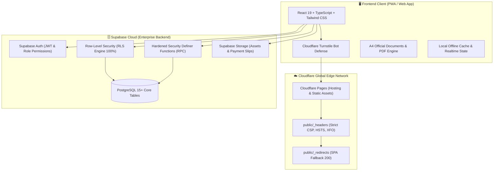
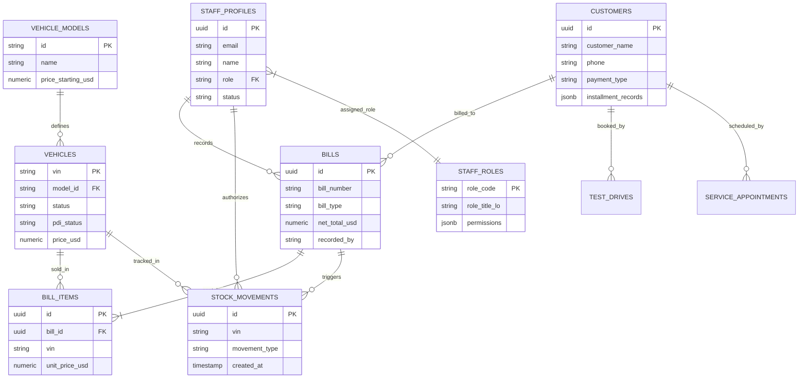
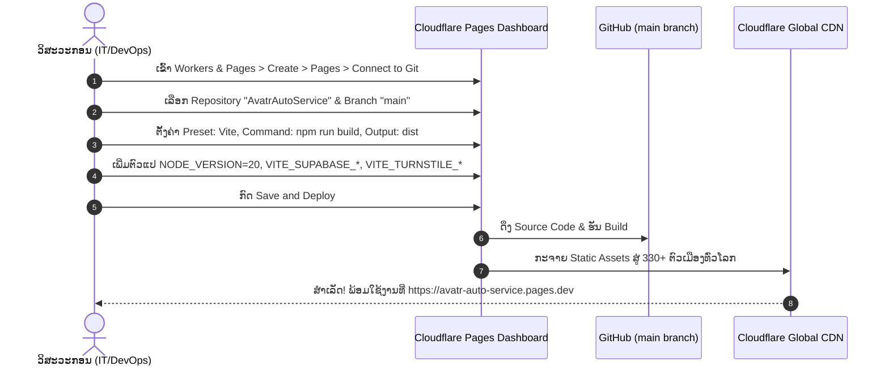

# ຄູ່ມືແມ່ບົດລະບົບ ແລະ ເອກະສານມອບ-ຮັບງານສະບັບສົມບູນ
## MASTER SYSTEM SPECIFICATION & HANDOVER HANDBOOK
### ລະບົບຄຸ້ມຄອງສູນບໍລິການ ແລະ ໂຊຣູມລົດໄຟຟ້າ AVATR (AvatrAutoService Laos)
**ສະບັບປັບປຸງທາງການ:** `v1.4.0 (Enterprise Cloudflare & Supabase Edition)`  
**ວັນທີມອບ-ຮັບງານ:** 14 ຕຸລາ (October) 2026

---

## 1. ບົດສະຫຼຸບພາບລວມ ແລະ ຂໍ້ມູນໂຄງການ (Executive Summary)

ເອກະສານສະບັບນີ້ຄື **ຄູ່ມືແມ່ບົດ (Master Handbook)** ທີ່ລວບລວມທັງ **ຄູ່ມືການໃຊ້ງານລະບົບ (Operational User Guide)** ສຳລັບຜູ້ບໍລິຫານ ແລະ ພະນັກງານ ພ້ອມທັງ **ສະເປັກເຊີງວິສະວະກຳ (Technical Architecture Specification)** ສຳລັບຝ່າຍ IT ແລະ Cyber Security ໂດຍແບ່ງອອກເປັນ **4 ພາກສ່ວນຫຼັກ (Four Core Pillars)** ຢ່າງຄົບຖ້ວນ:

1. **ສ່ວນທີ 1: ລະບົບເວັບແອັບພລິເຄຊັນ (Web Application & Functional Modules)**
2. **ສ່ວນທີ 2: ສະຖາປັດຕະຍະກຳຖານຂໍ້ມູນ (Database Architecture & Data Dictionary)**
3. **ສ່ວນທີ 3: ຄວາມປອດໄພທາງໄຊເບີ (Cybersecurity, Hardening & Zero-Leak Defense)**
4. **ສ່ວນທີ 4: ການ Deploy ແລະ ໂຄງສ້າງພື້ນຖານ Cloudflare Pages (Cloudflare Pages Edge Deployment & Infrastructure)**

### ຂໍ້ມູນສະເພາະໂຄງການ (Project Metadata)
- **ຊື່ລະບົບ:** AVATR Dealership CRM, POS & Auto Service Management
- **ເຈົ້າຂອງລະບົບ (Client):** ບໍລິສັດ ລາວທານີ ກົນຈັກໜັກ ຈຳກັດຜູ້ດຽວ (Laothani Tractor Sole Co., Ltd)
- **ທີ່ຕັ້ງໂຊຣູມ:** ຖະໜົນ ໄກສອນ ພົມວິຫານ, ບ້ານ ສີວິໄລ, ເມືອງ ໄຊທານີ, ນະຄອນຫຼວງວຽງຈັນ, ສປປ ລາວ
- **ສະພາບແວດລ້ອມການຕິດຕັ້ງ (Hosting & Infrastructure):**
  - **Edge Deployment & Hosting:** Cloudflare Pages (Global Edge Network)
  - **Bot Mitigation & Network Security:** Cloudflare Turnstile & Cloudflare Edge Headers
  - **Backend & Database:** Supabase Cloud Enterprise (PostgreSQL 15+)

---

## 2. ສະຖາປັດຕະຍະກຳລະບົບໂດຍລວມ (High-Level System Architecture)



---

## 3. ສ່ວນທີ 1: ລະບົບເວັບແອັບພລິເຄຊັນ (Part 1: Web Application & Operations)

### 3.1 ໂຄງສ້າງເທັກໂນໂລຢີ Frontend (Tech Stack)
- **Framework:** React 19 (Concurrent Rendering, ປະສິດທິພາບສູງ)
- **ພາສາພັດທະນາ:** TypeScript 5.7+ (Strict Type-Safety ປ້ອງກັນຂໍ້ຜິດພາດດ້ານການເງິນ)
- **Build Tool:** Vite 6 (Bundle splitting ໄວສູງ)
- **Styling:** Tailwind CSS 3.4 (Luxury Minimal Dark/Light Theme & Precision Print CSS)
- **Font Assets:** ຟອນພາສາລາວ Phetsarath WOFF2 ຝັງໃນລະບົບ (Local Caching) ຕັດການເພິ່ງພາ Google Fonts ພາຍນອກ ເພື່ອຄວາມໄວ ແລະ ຄວາມປອດໄພ

### 3.2 ໂມດູນການເຮັດວຽກຫຼັກຂອງລະບົບ (Core Functional Modules)

#### 1) ໂມດູນໂຊຣູມ ແລະ ລຸ້ນລົດ (Showroom & Model Catalog)
- ສະແດງລົດ AVATR 11, AVATR 12, AVATR 07 ພ້ອມລາຍລະອຽດສະເປັກ CLTC Range, ອັດຕາເລັ່ງ 0-100, ຂະໜາດແບັດເຕີຣີ CATL, ແລະ ລະບົບ Huawei ADS
- ຕົວເລືອກສີພາຍນອກ ແລະ ພາຍໃນແບບໂຕ້ຕອບ (Interactive Color Switcher)
- ສະແດງລາຄາເລີ່ມຕົ້ນ Realtime ທັງສະກຸນ **USD ($)** ແລະ **LAK (₭)**

#### 2) ໂມດູນຈຸດຂາຍ ແລະ ອອກບິນ (POS Sales & Cashier)
- ຄຳນວນອັດຕາແລກປ່ຽນອັດຕະໂນມັດ (USD, LAK, THB, CNY)
- ດຶງຮູບ **BCEL OnePay QR Code** ທາງການຂອງບໍລິສັດມາສະແດງທັນທີເມື່ອລູກຄ້າເລືອກຊຳລະດ້ວຍການໂອນ
- ຕັດສະຕັອກລົດອັດຕະໂນມັດປ່ຽນສະຖານະເປັນ `sold` ແບບ Atomic ປ້ອງກັນການຂາຍຊ້ຳຊ້ອນ

#### 3) ໂມດູນຮັບລົດເຂົ້າສາງ ແລະ ກວດສະພາບ PDI (Inbound Stock-In & Inventory)
- ບັນທຶກລະຫັດຖັງ VIN 17 ຕົວ ແລະ ເລກມໍເຕີ (Motor Serial)
- ບັນທຶກການກວດສະພາບ PDI (Pre-Delivery Inspection), ຊື່ຊ່າງກວດສອບ, ແລະ ຄັງສິນຄ້າປາຍທາງ
- ອອກໃບຮັບເຂົ້າສິນຄ້າ (Goods Receipt A4) ທາງການ

#### 4) ຊຸດເອກະສານທາງການ 5 ສະບັບ (Official A4 Documents Suite)
ຢູ່ໃນ [`src/components/modals/CustomerDocumentsModal.tsx`](file:///home/pheuang01/Projects/AvatrAutoService/src/components/modals/CustomerDocumentsModal.tsx) ຮອງຮັບການພິມ ແລະ ດາວໂຫຼດ PDF ໜ້າດຽວ A4 ຄົມຊັດ:
1. **ໃບສັນຍາສັ່ງຈອງ (Vehicle Booking Contract):** ສັນຍາຈອງລົດ, ລາຄາ, ເງິນມັດຈຳ, ຂອງແຖມ, ແລະ ເວລາສົ່ງມອບ
2. **ໃບຮັບເງິນ (Official Dealership Receipt):** ໃບຮັບເງິນມັດຈຳ/ເງິນດາວ ພ້ອມຊ່ອງເຊັນ 3 ຝ່າຍ (ລູກຄ້າ, ພະນັກງານຮັບເງິນ, ຫົວໜ້າບັນຊີ)
3. **ໃບມອບ-ຮັບລົດ (Vehicle Handover Certificate):** ເອກະສານສົ່ງມອບລົດ ພ້ອມລາຍການອຸປະກອນແຖມ (Home Charger 7kW, Adapter CCS2, ບັດ Bluedot)
4. **ໃບມອບສິດ (Power of Attorney):** ໃບມອບສິດທາງການເພື່ອຂຶ້ນທະບຽນ ແລະ ເອົາປ້າຍລົດນຳພະແນກ ຍຂຕ
5. **ຕາຕະລາງຜ່ອນຊຳລະ (Installment Repayment Schedule):** ຕາຕະລາງແບ່ງງວດແຕ່ລະເດືອນ ລະບຸເງິນຕົ້ນ, ດອກເບ້ຍ, ແລະ ຍອດຄົງເຫຼືອທັງ USD/LAK

#### 5) ໂມດູນຕິດຕາມຄ່າງວດ (Installment Ledger Dashboard)
- ບັນທຶກ ແລະ ຕິດຕາມການຊຳລະງວດ (Periods: 12 - 60 ເດືອນ)
- ອອກໃບບິນຮັບເງິນງວດຍ່ອຍພ້ອມເລກອ້າງອີງການໂອນ (Slip No.)

---

### 3.3 ຄູ່ມືການ Deploy ຜ່ານ Cloudflare Pages (Deployment Guide)

ລະບົບຖືກອອກແບບມາສຳລັບ **Cloudflare Pages** ໂດຍສະເພາະ:

```bash
# 1. ຕິດຕັ້ງ Dependencies
npm install

# 2. ທົດສອບ Build
npm run build
```

- **Framework Preset:** Vite
- **Build Command:** `npm run build`
- **Build Output Directory:** `dist`
- **Node.js Version:** `20+` ຫຼື `24`
- **ການຕັ້ງຄ່າ Routing & Headers (ຢູ່ໃນໂຟລເດີ public/):**
  - **`public/_redirects`:**
    ```text
    /* /index.html 200
    ```
    *(ຮັບປະກັນການເຮັດວຽກຂອງ Single Page Application ບໍ່ໃຫ້ເກີດ 404 ເມື່ອ Refresh ໜ້າ)*
  - **`public/_headers`:**
    ບັນຈຸ HTTP Security Headers ຄົບຊຸດ (CSP, HSTS, X-Frame-Options: DENY, nosniff, Cache-Control)

---

## 4. ສ່ວນທີ 2: ສະຖາປັດຕະຍະກຳຖານຂໍ້ມູນ (Part 2: Database Architecture)

### 4.1 ຖານຂໍ້ມູນ Supabase Cloud (PostgreSQL 15+)
- **Primary Schema:** `public`
- **Auth Engine:** Supabase GoTrue Auth (JWT Sessions)
- **Storage Buckets:** `dealership-assets` (Public Read ຮູບພາບລົດ ແລະ QR), `payment-slips` (Private Authenticated Read)

### 4.2 ແຜນຜັງຄວາມສຳພັນ (Entity-Relationship Diagram)



### 4.3 ຕາຕະລາງຫຼັກໃນລະບົບ (Core Tables Dictionary)
1. **`staff_profiles`:** ເກັບຂໍ້ມູນພະນັກງານ (id UUID, name, email, phone, role FK, department, status)
2. **`staff_roles`:** ເກັບລະຫັດສິດ ແລະ Permissions (`super_admin`, `admin`, `sales`, `technician`, `general_user`)
3. **`vehicle_models`:** ລຸ້ນລົດ ແລະ ສະເປັກ (AVATR 11, 12, 07, ລາຄາ, ສີ, ຄຸນສົມບັດ)
4. **`vehicles`:** ລົດແຕ່ລະຄັນໃນສາງ (vin PK 17 ຕົວ, model_id, status, pdi_status, engine_number, warehouse)
5. **`customers`:** ຂໍ້ມູນລູກຄ້າ CRM ແລະ ສັນຍາຜ່ອນ (customer_name, phone, id_card_number, installment_records JSONB)
6. **`bills` & `bill_items`:** ຫົວບິນ ແລະ ລາຍການບິນຂາຍ/ບິນງວດ/ບິນຮັບເຂົ້າ
7. **`stock_movements`:** ປະຫວັດການເຄື່ອນໄຫວສາງ (Audit Logs)
8. **`dealership_settings`:** ຄອນຟິກສູນ, ບັນຊີທະນາຄານ, ແລະ QR Code
9. **`service_appointments` & `test_drives`:** ຕາຕະລາງນັດໝາຍສ້ອມແປງ ແລະ ທົດລອງຂັບ

### 4.4 Stored Procedures / RPCs ຫຼັກ
- **`record_vehicle_bill`:** ບັນທຶກການຂາຍ, ຕັດສະຕັອກລົດ, ອອກບິນ, ສ້າງ stock movement, ແລະ ອັບເດດລູກຄ້າໃນ Transaction ດຽວ (Atomic)
- **`delete_vehicle_bill`:** ຍົກເລີກບິນ ແລະ ຄືນສະຕັອກລົດກັບມາເປັນ `ready` (ສະເພາະ Super Admin)
- **Security Hardening:** ທຸກຟັງຊັນລັອກ `SET search_path = public` ປ້ອງກັນ Search-path Injection 100%

---

## 5. ສ່ວນທີ 3: ຄວາມປອດໄພທາງໄຊເບີ (Part 3: Cybersecurity & Hardening)

### 5.1 ສະຖາປັດຕະຍະກຳ Zero-Leak (Zero-Leak Architecture)
- **Client Key Isolation:** Frontend ໄດ້ຮັບສະເພາະ `VITE_SUPABASE_ANON_KEY`
- **Active Runtime Guard:** [`src/backend/client.ts`](file:///home/pheuang01/Projects/AvatrAutoService/src/backend/client.ts) ມີລະບົບກວດຈັບ `assertSafeSupabaseEnv` ຖ້າພົບ Secret `service_role` ປົນເຂົ້າມາໃນ Client ລະບົບຈະ **Halt ການເຮັດວຽກທັນທີ**
- **Git Shield:** ໄຟລ໌ `.env`, `.env.local`, `.agents/`, ແລະ `skills-lock.json` ຖືກກັນໄວ້ໃນ `.gitignore` ບໍ່ຫຼຸດຂຶ້ນ Git

### 5.2 ຕາຕະລາງສິດ Row-Level Security (RLS Matrix)

| ຕາຕະລາງ | Public / Anon | ພະນັກງານ (Sales/Staff) | ຜູ້ຈັດການ (Admin) | ຜູ້ດູແລສູງສຸດ (Super Admin) |
| :--- | :---: | :---: | :---: | :---: |
| `staff_profiles` | ❌ ບໍ່ມີສິດ | 👁️ ອ່ານ Profile ຕົນເອງ | 👁️ ອ່ານ/ແກ້ໄຂ Profile | ⚡ ຈັດການໄດ້ 100% |
| `vehicle_models` | 👁️ ອ່ານ Catalog | 👁️ ອ່ານໄດ້ | ✏️ ເພີ່ມ/ແກ້ໄຂລຸ້ນ | ⚡ ລຶບລຸ້ນລົດໄດ້ |
| `vehicles` | ❌ ບໍ່ມີສິດ | 👁️ ອ່ານສະຕັອກ/ກວດ PDI | ✏️ ຮັບລົດເຂົ້າ/ແກ້ໄຂ | ⚡ ຈັດການໄດ້ 100% |
| `customers` | ❌ ບໍ່ມີສິດ | 👁️ ອ່ານ/ສ້າງ Lead/ພິມເອກະສານ | ✏️ ແກ້ໄຂຂໍ້ມູນລູກຄ້າ | ⚡ ລຶບລູກຄ້າໄດ້ |
| `bills` | ❌ ບໍ່ມີສິດ | 👁️ ອອກບິນຂາຍ/ອ່ານບິນ | 👁️ ອ່ານລາຍງານການເງິນ | ⚡ ລຶບບິນຜ່ານ Secure RPC |
| `dealership_settings`| 👁️ ອ່ານ QR ແລະ ບັນຊີ | 👁️ ອ່ານໄດ້ | 👁️ ອ່ານໄດ້ | ⚡ ອັບໂຫຼດ QR ແລະ ປ່ຽນບັນຊີ |

### 5.3 ຄວາມປອດໄພ Cloudflare Edge & Turnstile
- **Cloudflare Turnstile:** ປ້ອງກັນ Bot ແລະ Brute-Force Password ທີ່ໜ້າ Login ([`TurnstileWidget.tsx`](file:///home/pheuang01/Projects/AvatrAutoService/src/components/common/TurnstileWidget.tsx))
- **Strict Headers ([`public/_headers`](file:///home/pheuang01/Projects/AvatrAutoService/public/_headers)):**
  - `X-Frame-Options: DENY` (ປ້ອງກັນ Clickjacking)
  - `X-Content-Type-Options: nosniff` (ປ້ອງກັນ MIME Confusion)
  - `Strict-Transport-Security: max-age=31536000; includeSubDomains; preload` (ບັງຄັບ HTTPS 100%)
  - `Content-Security-Policy`: ອະນຸຍາດສະເພາະ Supabase Cloud ແລະ Cloudflare Challenges ເທົ່ານັ້ນ

### 5.4 ມາດຕະຖານປ້ອງກັນ OWASP Top 10
- **SQL Injection:** ປ້ອງກັນຜ່ານ Supabase Parameterized Client + Input Sanitizer ([`src/utils/security.ts`](file:///home/pheuang01/Projects/AvatrAutoService/src/utils/security.ts))
- **Broken Access Control:** ປ້ອງກັນດ້ວຍ RLS ທຸກຕາຕະລາງ 100%
- **Cryptographic Failures:** ລະຫັດຜ່ານຖືກ Hash ດ້ວຍ Argon2/bcrypt ຜ່ານ Supabase Auth

---

---

## 6. ສ່ວນທີ 4: ຄູ່ມືການ Deploy ຜ່ານ Cloudflare Pages (Part 4: Cloudflare Pages Edge Deployment)

ເບິ່ງຄູ່ມືສະບັບເຕັມລະອຽດໄດ້ທີ່: **[`docs/handover/04_cloudflare_deployment_guide.md`](file:///home/pheuang01/Projects/AvatrAutoService/docs/handover/04_cloudflare_deployment_guide.md)**

### 6.1 ຕຳແໜ່ງໄຟລ໌ ແລະ Path ສຳຄັນໃນລະບົບ (Key Configuration Paths)

- **HTTP Security Headers:** [`public/_headers`](file:///home/pheuang01/Projects/AvatrAutoService/public/_headers) (ກຳນົດ CSP, HSTS, X-Frame-Options: DENY)
- **SPA Fallback Redirects:** [`public/_redirects`](file:///home/pheuang01/Projects/AvatrAutoService/public/_redirects) (ກຳນົດ `/* /index.html 200` ປ້ອງກັນ 404 ເມື່ອ Refresh ໜ້າ)
- **Environment Template:** [`.env.example`](file:///home/pheuang01/Projects/AvatrAutoService/.env.example) (ແມ່ແບບຕົວແປສະພາບແວດລ້ອມສຳລັບ Cloudflare Pages)
- **Output Build Directory:** [`dist/`](file:///home/pheuang01/Projects/AvatrAutoService/dist) (ໄຟລ໌ Production Bundle ຫຼັງ Build)
- **Bot Guard Integration:** [`src/components/common/TurnstileWidget.tsx`](file:///home/pheuang01/Projects/AvatrAutoService/src/components/common/TurnstileWidget.tsx)

### 6.2 ຂັ້ນຕອນການ Deploy ຜ່ານ Cloudflare Dashboard (GUI Step-by-Step)



#### ຄ່າຕັ້ງຄ່າ Build Settings:
| ຊ່ອງຕັ້ງຄ່າ (Field) | ຄ່າທີ່ຕ້ອງປ້ອນ (Value) |
| :--- | :--- |
| **Project name** | `avatr-auto-service` |
| **Production branch** | `main` |
| **Framework preset** | `Vite` |
| **Build command** | `npm run build` |
| **Build output directory** | `dist` |
| **Root directory** | `/` (ຫຼື ປະວ່າງ) |

#### ຕົວແປສະພາບແວດລ້ອມ (Environment Variables):
- `NODE_VERSION` = `20`
- `VITE_SUPABASE_URL` = `<URL ຖານຂໍ້ມູນ Supabase Cloud>`
- `VITE_SUPABASE_ANON_KEY` = `<Anon Public Key>`
- `VITE_TURNSTILE_SITE_KEY` = `<Site Key ຈາກ Cloudflare Turnstile>`
- `VITE_APP_ENV` = `production`

> [!CAUTION]
> ຫ້າມໃສ່ `SUPABASE_SERVICE_ROLE_KEY` ໃນ Cloudflare Pages Environment Variables ເດັດຂາດ ເພື່ອຮັກສາຫຼັກການ Zero-Leak Architecture!

### 6.3 ຂັ້ນຕອນການ Deploy ຜ່ານ Wrangler CLI

ວິທີການສັ່ງ Deploy ຜ່ານ Terminal ໂດຍກົງ:
```bash
# 1. ກວດສອບ Lint ແລະ ສ້າງ Build
npm run lint
npm run build

# 2. ເຂົ້າສູ່ລະບົບ Cloudflare
npx wrangler login

# 3. Deploy ໂຟລເດີ dist ຂຶ້ນ Cloudflare Pages
npx wrangler pages deploy dist --project-name=avatr-auto-service --branch=main
```

### 6.4 ການຕັ້ງຄ່າ Cloudflare Turnstile Bot Defense
1. ໄປທີ່ Cloudflare Dashboard > **Turnstile** > **Add site**
2. ຕັ້ງຊື່: `AvatrAutoService Login Guard`
3. Domain: ໃສ່ `avatr-auto-service.pages.dev` ແລະ `localhost`
4. Mode: ເລືອກ **Managed**
5. ນຳເອົາ **Site Key** ໄປໃສ່ໃນຕົວແປ `VITE_TURNSTILE_SITE_KEY` ໃນ Cloudflare Pages

---

## 7. ລາຍການກວດຮັບງານ ແລະ ໃບມອບ-ຮັບ (Acceptance Testing & Sign-Off)

### 7.1 ລາຍການກວດສອບການທົດສອບ (User Acceptance Testing Checklist)

| ລ/ດ | ຫົວຂໍ້ການທົດສອບ | ວິທີການທົດສອບ | ຜົນການທົດສອບຕົວຈິງ | ສະຖານະ |
| :---: | :--- | :--- | :--- | :---: |
| 1 | **Frontend Build** | ຮັນ `npm run build` | ສຳເລັດໃນ 1.65 ວິນາທີ ໄຮ້ Error | ✅ ຜ່ານ |
| 2 | **Cloudflare Headers** | ກວດສອບໄຟລ໌ `public/_headers` | ມີ CSP, HSTS, XFO ຄົບຖ້ວນ | ✅ ຜ່ານ |
| 3 | **Cloudflare Redirects**| ກວດສອບ `public/_redirects` | ມີ SPA fallback `/* /index.html 200` | ✅ ຜ່ານ |
| 4 | **Database Connectivity**| ທົດສອບ Query Supabase Cloud | Latency ສະເລ່ຍ 160-360ms ເຊື່ອມຕໍ່ປົກກະຕິ | ✅ ຜ່ານ |
| 5 | **RLS Security Policy** | ທົດສອບ Query ແບບ Anonymous | ລະບົບບຼັອກຕາຕະລາງພາຍໃນ (401) ຕາມສິດ | ✅ ຜ່ານ |
| 6 | **A4 Documents Suite** | ທົດສອບພິມເອກະສານ 5 ສະບັບ | ສະແດງ Preview A4 ໜ້າດຽວຄົມຊັດ ສົ່ງອອກ PDF ໄດ້ | ✅ ຜ່ານ |
| 7 | **Zero-Leak Validation** | ກວດສອບ Git Tracking | `.agents/`, `.env`, keys ບໍ່ຫຼຸດຂຶ້ນ Git | ✅ ຜ່ານ |
| 8 | **Edge Deployment SOP** | ກວດສອບຄູ່ມື `04_cloudflare_deployment_guide.md` | ມີຂັ້ນຕອນ GUI/CLI ແລະ Path ຊັດເຈນ | ✅ ຜ່ານ |
| 9 | **Turnstile Bot Guard** | ທົດສອບ Widget ໜ້າ Login | ກວດສອບມະນຸດອັດຕະໂນມັດ ປ້ອງກັນ Brute Force | ✅ ຜ່ານ |

### 7.2 ໃບຢັ້ງຢືນການມອບ-ຮັບງານທາງການ (Official Sign-Off Form)

| ຝ່າຍມອບງານ (System Development & Architecture Team) | ຝ່າຍກວດຮັບງານ (Laothani Tractor Sole Co., Ltd) |
| :--- | :--- |
| **ລາຍເຊັນ:** _______________________________________ | **ລາຍເຊັນ:** _______________________________________ |
| **ຊື່ແຈ້ງ:** ວິສະວະກອນຜູ້ພັດທະນາລະບົບ | **ຊື່ແຈ້ງ:** _______________________________________ |
| **ຕຳແໜ່ງ:** Lead Full-Stack Architect | **ຕຳແໜ່ງ:** ຜູ້ຈັດການທົ່ວໄປ / ຫົວໜ້າຝ່າຍ IT |
| **ວັນທີ:** 14 ຕຸລາ (October) 2026 | **ວັນທີ:** _____ / _____ / 2026 |
