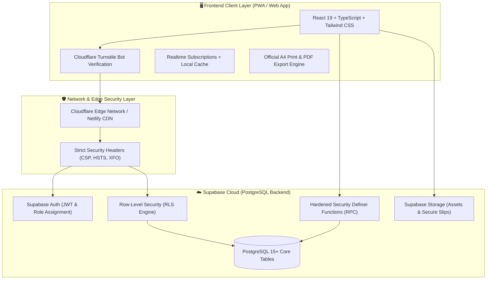

# ບົດສະຫຼຸບພາບລວມການມອບ-ຮັບໂຄງການ (PROJECT HANDOVER EXECUTIVE SUMMARY)
## ລະບົບຄຸ້ມຄອງສູນບໍລິການ ແລະ ໂຊຣູມລົດໄຟຟ້າ AVATR (AvatrAutoService Laos)

---

### 1. ບົດນຳສະເໜີ ແລະ ຈຸດປະສົງ (Project Overview & Purpose)
ເອກະສານສະບັບນີ້ ຖືກຈັດທຳຂຶ້ນເພື່ອເປັນ **ເອກະສານມອບ-ຮັບງານທາງການ (Official Technical Handover Documentation)** ສຳລັບໂຄງການ **AvatrAutoService Laos** ໂດຍແບ່ງອອກເປັນ **3 ພາກສ່ວນຫຼັກ (Three Core Parts)** ຕາມມາດຕະຖານວິສະວະກຳຊອບແວລະດັບ Enterprise:

1. **[ສ່ວນທີ 1: ລະບົບເວັບແອັບພລິເຄຊັນ ແລະ ການມອບ-ຮັບງານ (Part 1: Web Application & Deliverables)](./01_web_deliverables.md)**
   - ສະຖາປັດຕະຍະກຳ Frontend (React 19, TypeScript, Vite, Tailwind CSS)
   - ໂຄງສ້າງລະບົບງານ: ໂຊຣູມ (Showroom), ການຂາຍ (POS), ສາງ (Inventory), ບິນ & ເອກະສານ A4 (A4 Print Engine), ລະບົບຄ່າງວດ (Installments Ledger), ແລະ ການຈັດການຜູ້ໃຊ້ (RBAC)
   - ລາຍການກວດຮັບງານ (Acceptance Checklist) ແລະ ຂັ້ນຕອນການທົດສອບ
2. **[ສ່ວນທີ 2: ສະຖາປັດຕະຍະກຳຖານຂໍ້ມູນ (Part 2: Database Architecture & Data Dictionary)](./02_database_schema.md)**
   - ໂຄງສ້າງຖານຂໍ້ມູນ Supabase Cloud (PostgreSQL 15+)
   - ຕາຕະລາງ, ຄວາມສຳພັນ (ER Diagram), Data Dictionary, Functions/RPCs (`record_vehicle_bill`, `delete_vehicle_bill`)
   - ປະຫວັດການຍ້າຍຖານຂໍ້ມູນ (Migrations History) ແລະ ແຜນການກູ້ຄືນຂໍ້ມູນ (Backup & Disaster Recovery)
3. **[ສ່ວນທີ 3: ຄວາມປອດໄພທາງໄຊເບີ ແລະ ການປ້ອງກັນຂໍ້ມູນ (Part 3: Cybersecurity, Zero-Leak & Hardening)](./03_cybersecurity.md)**
   - ຫຼັກການ Zero-Leak Architecture (ປ້ອງກັນ Service Role Key ຮົ່ວໄຫຼ)
   - ຕາຕະລາງ Row-Level Security (RLS Matrix) ແລະ ການຄວບຄຸມສິດ (RBAC Matrix)
   - Cloudflare Turnstile Bot Defense, HTTP Security Headers, ແລະ ການປ້ອງກັນຊ່ອງໂຫວ່ຕາມມາດຕະຖານ OWASP Top 10

---

### 2. ໂຄງສ້າງລະບົບພາບລວມ (High-Level System Architecture)

---

### 3. ສາລະບານເອກະສານ 3 ພາກສ່ວນ (Table of Contents & Navigation)

| ພາກສ່ວນ (Part) | ເອກະສານ (Document) | ເນື້ອໃນຫຼັກ (Core Contents) | ສະຖານະ (Status) |
| :--- | :--- | :--- | :---: |
| **ສ່ວນທີ 1 (Part 1)** | [01_web_deliverables.md](./01_web_deliverables.md) | ສະຖາປັດຕະຍະກຳເວັບ, ໂມດູນທັງໝົດ, ການອອກແບບ A4, ຄູ່ມືການ Deploy, ລາຍການກວດຮັບ | ✅ ສຳເລັດ (Ready) |
| **ສ່ວນທີ 2 (Part 2)** | [02_database_schema.md](./02_database_schema.md) | PostgreSQL Schema, ERD, Data Dictionary, Stored Procedures, Migrations, Backup SOP | ✅ ສຳເລັດ (Ready) |
| **ສ່ວນທີ 3 (Part 3)** | [03_cybersecurity.md](./03_cybersecurity.md) | Zero-Leak Guard, RLS Matrix, RBAC, Definer Hardening, Turnstile, OWASP Top 10 | ✅ ສຳເລັດ (Ready) |

---

### 4. ຂໍ້ມູນສະເພາະໂຄງການ (Project Metadata)

- **ຊື່ລະບົບ (System Name):** AVATR Dealership CRM, POS & Auto Service Management
- **ເວີຊັນ (Version):** `v1.4.0` (Production Hardened Release)
- **ບໍລິສັດເຈົ້າຂອງລະບົບ (Client / Dealership):** ບໍລິສັດ ລາວທານີ ກົນຈັກໜັກ ຈຳກັດຜູ້ດຽວ (Laothani Tractor Sole Co., Ltd)
- **ສະຖານທີ່ຕັ້ງ (Location):** ຖະໜົນ ໄກສອນ ພົມວິຫານ, ບ້ານ ສີວິໄລ, ເມືອງ ໄຊທານີ, ນະຄອນຫຼວງວຽງຈັນ, ສປປ ລາວ
- **ສະພາບແວດລ້ອມການຕິດຕັ້ງ (Hosting / Runtime):**
  - **Frontend:** Netlify Global Edge (Node.js 24 runtime, Vite Build)
  - **Backend & Database:** Supabase Cloud Enterprise Infrastructure (PostgreSQL 15+)
  - **Domain & Security:** Cloudflare CDN & Turnstile Bot Mitigation

---

### 5. ໃບຢັ້ງຢືນການມອບ-ຮັບງານ (Handover Sign-Off Form)

ເອກະສານສະບັບນີ້ຢັ້ງຢືນວ່າ ລະບົບຊອບແວໄດ້ຮັບການພັດທະນາ, ທົດສອບ, ແລະ ຕິດຕັ້ງຕາມມາດຕະຖານທີ່ໄດ້ຕົກລົງກັນຢ່າງຄົບຖ້ວນສົມບູນ.

| ຝ່າຍມອບງານ (System Engineering Team) | ຝ່າຍກວດຮັບງານ (Laothani Authorized Representative) |
| :--- | :--- |
| **ລາຍເຊັນ (Signature):** ___________________________ | **ລາຍເຊັນ (Signature):** ___________________________ |
| **ຊື່ແຈ້ງ (Full Name):** ວິສະວະກອນຜູ້ພັດທະນາລະບົບ | **ຊື່ແຈ້ງ (Full Name):** ___________________________ |
| **ຕຳແໜ່ງ (Position):** Lead Full-Stack Architect | **ຕຳແໜ່ງ (Position):** ຜູ້ຈັດການທົ່ວໄປ / ຫົວໜ້າ IT |
| **ວັນທີ (Date):** 13 ຕຸລາ (October) 2026 | **ວັນທີ (Date):** _____ / _____ / 2026 |
